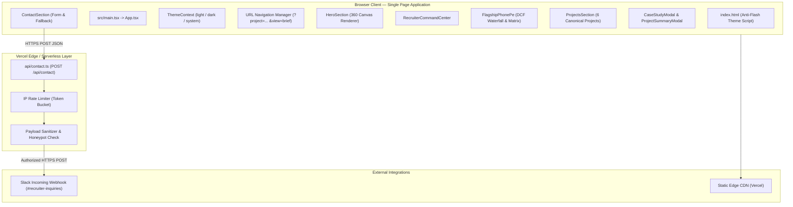

# System Architecture Specification (ARCHITECTURE.md)

**Document Version:** 1.0.0  
**Status:** IMPLEMENTED & AUDITED  
**Repository:** `C:\Users\kaust\OneDrive\Desktop\portfolio`

---

## 1. High-Level Architecture Overview

The application is architected as a lean, client-side Single Page Application (SPA) built with **React 18**, **TypeScript**, and **Vite**, deployed on **Vercel Edge/Static Infrastructure**, complemented by a single standalone serverless function (`api/contact.ts`) for webhook dispatching.



---

## 2. Directory Structure & Modular Breakdown

```text
portfolio/
├── .agents/                 # AGY skills and guidelines
├── .codex/                  # Hook configurations
├── api/                     # Serverless endpoints
│   └── contact.ts           # Standalone Vercel contact API
├── docs/                    # Technical specifications and planning documents
├── public/                  # Static assets
│   ├── frames/              # 64 WebP frames for 360° hero character
│   ├── Kaustubh_Nandurkar_Resume.pdf  # PROTECTED RESUME (96,435 bytes)
│   ├── personal-story.mp4   # Deferred personal story video
│   └── intro.mp4            # Hero loop character video
├── scripts/                 # Automated test, audit, and verification scripts
├── src/
│   ├── components/
│   │   ├── about/           # AboutSection, career narrative & deferred video
│   │   ├── command/         # RecruiterCommandCenter (quick jump & profile)
│   │   ├── common/          # Modals, ThemeToggle, BackToTop, ErrorBoundary
│   │   ├── contact/         # Contact form, mailto generator, clipboard fallback
│   │   ├── faq/             # Factual recruiter FAQ accordion
│   │   ├── flagship/        # PhonePe DCF waterfall chart, sensitivity matrix
│   │   ├── hero/            # CharacterCanvas, eye-tracking lerp engine
│   │   ├── journey/         # Professional & academic timeline
│   │   ├── metrics/         # EvidenceTelemetryBar (audited totals)
│   │   ├── navigation/      # Sticky Header, mobile drawer, scroll progress
│   │   ├── projects/        # Canonical project catalog, modals, DQ matrix
│   │   ├── research/        # Academic dissertations & publications
│   │   ├── resume/          # ResumeSection (preview & download actions)
│   │   └── skills/          # Competency taxonomy & tool groupings
│   ├── config/              # Central profile & social links configuration
│   ├── context/             # ThemeContext provider
│   ├── data/                # Governed analytical data records (single source of truth)
│   ├── types/               # TypeScript interface contracts
│   ├── App.tsx              # Main application tree & URL sync
│   ├── index.css            # Tailwind directives, print styles, overflow bounds
│   └── main.tsx             # DOM root mount
├── package.json             # Build scripts & production dependencies
├── tailwind.config.js       # Design tokens & color system
├── tsconfig.json            # Strict TypeScript configuration
└── vite.config.ts           # Vite bundler build settings
```

---

## 3. Core Subsystems

### 3.1 Financial Valuation & Waterfall Engine (`src/components/flagship/`)
- Pure client-side mathematical evaluation engine (`valuationSensitivityMath.ts`).
- Calculates Enterprise Value ($\text{EV} = ₹33,431.99\text{ Cr}$) to Equity Value ($\text{Equity Value} = ₹41,631.22\text{ Cr}$) adjustments.
- Real-time recalculation across 25 WACC $\times$ Terminal Growth matrix nodes without external library overhead.
- Supports PDF valuation executive summary generation via jsPDF integration.

### 3.2 Canonical Project Registry & Navigation (`src/data/projects.ts`, `projectNavigation.ts`)
- Governs exactly six canonical projects with standardized IDs:
  1. `phonepe-valuation` (PhonePe Pre-IPO DCF Valuation)
  2. `stratos-governance` (STRATOS Retail Decision Intelligence)
  3. `spiideo-sports-analytics` (SPIIDEO Sports Video Event Tagging)
  4. `it-support-analytics` (IT Support Service Intelligence)
  5. `smartbank-360` (SmartBank 360 FinTech Feasibility)
  6. `equitrack-analytics-os` (EquiTrack Analytics OS Prototype)
- Deep-link synchronization using HTML5 History API:
  - `?project=<id>` opens full case study.
  - `?project=<id>&view=brief` opens 30-second executive summary.
  - `popstate` event listeners guarantee native browser Back/Forward navigation.

### 3.3 360° Character Canvas Engine (`src/components/hero/CharacterCanvas.tsx`)
- High-performance 2D canvas tracking cursor coordinates.
- Calculates target angular position and applies shortest-path angular linear interpolation (`lerpAngle(current, target, 0.26)`), settling in $\sim 35\text{ ms}$.
- Uses a 12% screen radius deadzone around the character's face to trigger direct forward eye contact (`center.webp`).
- Automatically disabled under `prefers-reduced-motion` or touch devices to conserve power.

---

## 4. Build, Compilation & Execution Pipeline

- **Type Checking:** Runs strict TypeScript validation on both application (`typecheck:app`) and serverless API (`typecheck:api`).
- **Production Build:** Vite outputs optimized ES modules to `dist/`, hashing static assets.
- **Vercel Deployment:** Deploys static bundle to Vercel CDN; serverless function `/api/contact` is executed at the edge.

---

## 5. Architectural Invariants & Constraints
- **Zero Database Requirement:** All analytical data is bundled as immutable, strongly typed client-side records.
- **Zero Client Secret Exposure:** Client builds never contain secret keys or incoming webhook endpoints.
- **Strict Resume Protection:** `public/Kaustubh_Nandurkar_Resume.pdf` is an immutable, hand-verified PDF artifact (96,435 bytes).

---

## 6. Cross References
- Product Requirements: [`PRD.md`](file:///PRD.md)
- Decisions & Rationale: [`DECISIONS.md`](file:///DECISIONS.md)
- Data Governance: [`PROJECT_CONTEXT.md`](file:///PROJECT_CONTEXT.md)
- API Specifications: [`API.md`](file:///API.md)

