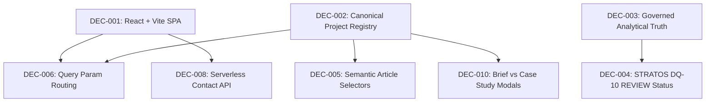

# Architecture & Project Decisions

## Purpose
This document records verified architectural, technical, security, data-governance, and business-logic decisions for the Kaustubh Nandurkar Portfolio application. Its primary objective is to preserve intentional constraints and established rationale so that future human developers and autonomous AI coding agents do not repeatedly re-infer, contradict, or inadvertently undo deliberate engineering choices.

---

## Rules for Future AI Agents
- **Mandatory Pre-read:** Always read this file before making or proposing any architectural, data-layer, or structural modifications.
- **Treat CONFIRMED as Hard Constraints:** Decisions marked `CONFIRMED` represent validated architectural and governance choices. Never contradict or modify them without explicit, written human authorization.
- **No Silent Replacements:** Never replace an existing architectural pattern or implementation choice with your personal or default framework preference.
- **Preserve Governance Over "Cleaner" Code:** In analytics and data governance (e.g. STRATOS DQ-10, PhonePe valuation modeling), never perform silent imputation, synthetic benchmark creation, or clean up anomalies that are intentionally flagged for human/executive review.
- **Handle Uncertainty Transparently:** If a decision is marked `INFERRED — NOT CONFIRMED` or is undocumented, do not fabricate rationale. State that the rationale is unknown or inferred from implementation evidence.
- **Adhere to the Change Protocol:** Follow the formal Change Protocol (defined at the end of this document) whenever an architectural change is contemplated.

---

## Decision Index

| ID | Decision Name | Status | Area |
| :--- | :--- | :--- | :--- |
| `DEC-001` | Client-Side SPA Stack (React + TypeScript + Vite) | `CONFIRMED` | Architecture |
| `DEC-002` | Canonical Single-Source-of-Truth Project Registry (`src/data/projects.ts`) | `CONFIRMED` | Architecture / Data |
| `DEC-003` | Governed Analytical Truth & Zero Silent Imputation (STRATOS & PhonePe) | `CONFIRMED` | Data Governance |
| `DEC-004` | STRATOS DQ-10 Retained as Active REVIEW State | `CONFIRMED` | Data Governance / Business Logic |
| `DEC-005` | Semantic Card Discovery via `<article data-project-id="...">` | `CONFIRMED` | Frontend / Testing |
| `DEC-006` | Query-Parameter Driven Deep Linking (`?project=` & `&view=`) with `popstate` | `CONFIRMED` | Architecture / UX |
| `DEC-007` | Protected Resume PDF Baseline Immutability (SHA-1 Strict Protection) | `CONFIRMED` | Operations / Asset Governance |
| `DEC-008` | Serverless Contact Pipeline with Truthful 503 Fallback & Zero Secret Leaks | `CONFIRMED` | Backend / Security |
| `DEC-009` | Restrained Editorial Dark Theme System with Anti-Flash Script | `CONFIRMED` | Frontend / UX |
| `DEC-010` | Separation of Modal Briefs (`ProjectSummaryModal`) vs Deep Case Studies (`CaseStudyModal`) | `CONFIRMED` | Frontend / UX |

---

## Decisions

### DEC-001 — Client-Side SPA Stack (React + TypeScript + Vite)
- **Status:** `CONFIRMED`
- **Area:** Architecture
- **Decision:** The application is architected as a lean, client-side Single Page Application (SPA) built with React 18, TypeScript, and Vite, deployed on static edge hosting (Vercel).
- **Why:** Delivers instant, predictable client-side transitions and zero cold-start database latency for recruiters reviewing portfolio case studies, while maintaining strict type safety across analytical data records.
- **Problem Solved:** Avoids complex server infrastructure, SSR operational overhead, and database provisioning costs for a personal executive portfolio.
- **Alternatives Considered:** Next.js (App Router), Remix, static Hugo/Jekyll site.
- **Why Alternatives Were Rejected:** Next.js and Remix introduce unnecessary SSR/server infrastructure complexity for a static portfolio. Static generators lack rich interactive client-side components needed for dynamic valuation waterfall charts and interactive scenario modeling.
- **Constraints:** All interactive case studies and charting must execute entirely within the browser without requiring a dedicated backend database.
- **Impact:** Entire frontend tree (`src/`), build tooling (`vite.config.ts`, `package.json`).
- **Evidence:** `package.json`, `vite.config.ts`, `tsconfig.json`, `src/main.tsx`.
- **Change Risk:** Migrating to an SSR framework would alter routing, asset loading, deployment configurations, and require rewriting client-side interactive state.
- **Related Decisions:** `DEC-006`, `DEC-008`.

---

### DEC-002 — Canonical Single-Source-of-Truth Project Registry (`src/data/projects.ts`)
- **Status:** `CONFIRMED`
- **Area:** Architecture / Data
- **Decision:** Exactly six canonical projects exist, defined centrally in `src/data/projects.ts` with standardized IDs, metadata, KPIs, and evidence classifications.
- **Why:** Eliminates fragmented, inconsistent project data across components. Guarantees that the Hero, Recruiter Command Center, Projects Section, Search Modal, and Deep Modals render uniform metrics and methodology qualifications.
- **Problem Solved:** Prevents out-of-sync KPI figures, conflicting project titles, and duplicate project definitions across different UI views.
- **Alternatives Considered:** Loading project records via external CMS, headless GraphQL, or markdown frontmatter files.
- **Why Alternatives Were Rejected:** External CMS introduces external runtime dependencies, latency, and failure points. Markdown frontmatter lacks rich, strongly-typed TypeScript validation for financial valuation matrices and data quality states.
- **Constraints:** Canonical project IDs (`phonepe-valuation`, `stratos-governance`, `spiideo-sports-analytics`, `it-support-analytics`, `smartbank-360`, `equitrack-analytics-os`) are immutable contracts across navigation and URLs.
- **Impact:** `src/data/projects.ts`, `ProjectsSection.tsx`, `RecruiterCommandCenter.tsx`, `CaseStudyModal.tsx`, `ProjectSummaryModal.tsx`, `projectNavigation.ts`.
- **Evidence:** `src/data/projects.ts`, `src/types/project.ts`.
- **Change Risk:** Renaming or mutating canonical IDs breaks inbound shared links, bookmarks, search indexing, and deep-link routing.
- **Related Decisions:** `DEC-005`, `DEC-006`, `DEC-010`.

---

### DEC-003 — Governed Analytical Truth & Zero Silent Imputation (STRATOS & PhonePe)
- **Status:** `CONFIRMED`
- **Area:** Data Governance
- **Decision:** Strictly adhere to the governance principle: `PRESERVE -> DOCUMENT -> FLAG -> GOVERN`. Never silently impute missing data, fabricate synthetic benchmarks, convert unassigned attribution to zero, or state causal certainty from observational models.
- **Why:** The author's professional positioning is grounded in rigorous financial research and governed enterprise analytics. Fabricating data or masking discrepancies destroys credibility in executive and technical recruiter evaluation.
- **Problem Solved:** Mitigates the common flaw in analytics portfolios where data is artificially smoothed or sanitized to create false perfection.
- **Alternatives Considered:** Normalizing anomalies or showing clean synthetic demo metrics.
- **Why Alternatives Were Rejected:** Rejected because real-world analytics engineering requires surfacing data discrepancies and governance controls, not hiding them.
- **Constraints:** PhonePe DCF valuation outputs must be qualified explicitly as `MODEL ESTIMATE`. SPIIDEO turnaround must be identified as `OPERATIONAL SLA`. IT Support metrics must be labeled as `STUDY ESTIMATE`. EquiTrack demo is a `PROTOTYPE DEMO`.
- **Impact:** Copy and visual badges across `FlagshipPhonePe.tsx`, `ValuationWaterfallChart.tsx`, `StratosDQMatrix.tsx`, `DecisionIntelligenceBlock.tsx`, `src/data/projects.ts`.
- **Evidence:** `.user_rules` (`RULE[user_global]`), `src/components/projects/StratosDQMatrix.tsx`, `src/data/projects.ts`.
- **Change Risk:** Modifying metrics or removing qualifications destroys the analytical integrity and violates core project operating rules.
- **Related Decisions:** `DEC-004`.

---

### DEC-004 — STRATOS DQ-10 Retained as Active REVIEW State
- **Status:** `CONFIRMED`
- **Area:** Data Governance / Business Logic
- **Decision:** Data Quality anomaly DQ-10 (`Net Revenue > Gross Revenue in controlled totals`) must strictly remain in `REVIEW` status. It must never be marked as resolved, repaired, or dismissed.
- **Why:** In the governed upstream source of truth (Google Sheets + Apps Script project), this transaction anomaly is an active, open reconciliation item requiring human executive audit. Resolving it in the portfolio UI would create a parallel, fabricated analytical truth.
- **Problem Solved:** Prevents frontend developers or AI agents from "fixing" an intentional business discrepancy.
- **Alternatives Considered:** Hardcoding a simulated database correction to show a 100% clean data quality score.
- **Why Alternatives Were Rejected:** Explicitly forbidden by project rules (`RULE[user_global]`: *"DQ-10 remains REVIEW unless the governed source explicitly changes its status... Never represent this as resolved"*).
- **Constraints:** The UI must display the badge as `REVIEW` and articulate the analytical reconciliation step.
- **Impact:** `src/components/projects/StratosDQMatrix.tsx`, `src/data/projects.ts`.
- **Evidence:** `RULE[user_global]`, `src/components/projects/StratosDQMatrix.tsx` lines 14-38.
- **Change Risk:** Changing the status violates client governance requirements and misrepresents audit findings.
- **Related Decisions:** `DEC-003`.

---

### DEC-005 — Semantic Card Discovery via `<article data-project-id="...">`
- **Status:** `CONFIRMED`
- **Area:** Frontend / Testing
- **Decision:** Every canonical project card in the project catalog is rendered with a semantic `<article>` element carrying an explicit attribute `data-project-id="{project.id}"`.
- **Why:** Previous DOM queries using generic CSS classes (`#projects .grid > div`) erroneously counted nested sub-grids, brief wrappers, and metric tiles, reporting 42 elements instead of the 6 canonical projects.
- **Problem Solved:** Guarantees deterministic, reproducible end-to-end and CDP testing of card counts, search results, category filtering, and empty-state resets.
- **Alternatives Considered:** Counting by class name (`.project-card`) or counting title elements.
- **Why Alternatives Were Rejected:** Class names are vulnerable to styling refactors and utility-class shifts (Tailwind CSS). Semantic `<article data-project-id>` is robust, accessible, and self-documenting.
- **Constraints:** Any future card UI refactoring must preserve `<article data-project-id={project.id}>` at the card root.
- **Impact:** `src/components/projects/ProjectsSection.tsx`, test suites in `scripts/targeted_explorer_audit.mjs`.
- **Evidence:** `src/components/projects/ProjectsSection.tsx`, `scripts/targeted_explorer_audit.mjs`.
- **Change Risk:** Removing or nesting the attribute breaks automated QA audit scripts and causes false regression failures.
- **Related Decisions:** `DEC-002`.

---

### DEC-006 — Query-Parameter Driven Deep Linking (`?project=` & `&view=`) with `popstate`
- **Status:** `CONFIRMED`
- **Area:** Architecture / UX
- **Decision:** Modal views are synchronized with the browser address bar using URL search parameters: `?project=<canonical-id>` for full case studies and `?project=<canonical-id>&view=brief` for executive briefs, backed by `window.history.pushState` and `window.addEventListener('popstate', ...)`.
- **Why:** Enables recruiters and hiring managers to bookmark, share, and paste direct links to specific case studies while allowing the browser's native Back/Forward buttons to open and close modals naturally.
- **Problem Solved:** Resolves modal state loss on page refresh, broken browser Back button navigation, and unshareable modal content.
- **Alternatives Considered:** Hash-based routing (`#project-id`) or a full client-side router (`react-router-dom`).
- **Why Alternatives Were Rejected:** Hash routing conflicts with in-page anchor links (`#projects`, `#contact`, `#about`). `react-router-dom` adds unnecessary bundle weight and routing complexity for an SPA whose entire layout exists on a single page.
- **Constraints:** Unknown project IDs must fall back gracefully to the closed state without crashing; unsupported view parameters default safely to the full case study.
- **Impact:** `src/components/projects/projectNavigation.ts`, `src/App.tsx`, `src/components/projects/CaseStudyModal.tsx`, `src/components/projects/ProjectSummaryModal.tsx`.
- **Evidence:** `src/components/projects/projectNavigation.ts`, `scripts/test_shareable_urls.mjs`.
- **Change Risk:** Tampering with navigation helper functions breaks external links, sharing buttons, and browser history synchronization.
- **Related Decisions:** `DEC-001`, `DEC-002`.

---

### DEC-007 — Protected Resume PDF Baseline Immutability (SHA-1 Strict Protection)
- **Status:** `CONFIRMED`
- **Area:** Operations / Asset Governance
- **Decision:** The resume file located at `public/Kaustubh_Nandurkar_Resume.pdf` is strictly protected: exact file size `96,435` bytes, exact SHA-1 hash `317857D88309548D9D05E8198FFBF8212C88470C`.
- **Why:** The PDF is an author-curated, officially signed executive resume artifact. Automated scripts or AI tools must never overwrite, re-export, or modify this file.
- **Problem Solved:** Prevents accidental file corruption, markdown-to-pdf conversion overwrites, or stale resume builds.
- **Alternatives Considered:** Dynamic PDF generation from HTML/React.
- **Why Alternatives Were Rejected:** Automated HTML-to-PDF rendering frequently produces visual clipping, improper margins, and imperfect page breaks that look unpolished to recruiters.
- **Constraints:** All automated preflight and release audits must verify the SHA-1 hash and halt or report failure if altered.
- **Impact:** `public/Kaustubh_Nandurkar_Resume.pdf`, all preflight audit scripts.
- **Evidence:** Audit logs, user instructions, SHA-1 checksum verifications.
- **Change Risk:** Changing or touching the file invalidates release readiness and violates mandatory safety guidelines.

---

### DEC-008 — Serverless Contact Pipeline with Truthful 503 Fallback & Zero Secret Leaks
- **Status:** `CONFIRMED`
- **Area:** Backend / Security
- **Decision:** The contact form endpoint is implemented as a standalone serverless function (`api/contact.ts`) that dispatches to a Slack incoming webhook. Client-side code never receives webhook URLs or API secrets. If `SLACK_WEBHOOK_URL` is omitted in the environment, the endpoint returns an honest HTTP 503 (`SERVICE_UNCONFIGURED`) and directs the client to use direct email/clipboard fallback.
- **Why:** Protects credentials from client-side bundle leakage and prevents silent submission failures. Users are never falsely told their message was delivered when the dispatch backend is unconfigured.
- **Problem Solved:** Eliminates credential exposure, spam vulnerability, and silent drop-offs in serverless contact forms.
- **Alternatives Considered:** Hardcoding a webhook in client environment variables (`VITE_SLACK_WEBHOOK`), or client-side third-party services (EmailJS, Formspree).
- **Why Alternatives Were Rejected:** Client-side environment variables expose secrets to web scrapers. External SaaS form endpoints introduce third-party privacy tracking and branding.
- **Constraints:** Includes IP rate limiting (5 requests per 10 minutes), honeypot anti-spam traps, and RFC-compliant input sanitization.
- **Impact:** `api/contact.ts`, `src/components/contact/ContactSection.tsx`, `scripts/test_contact_api.mjs`.
- **Evidence:** `api/contact.ts`, `docs/portfolio-integrations.md`, `scripts/test_contact_api.mjs`.
- **Change Risk:** Exposing environment variables or changing status codes breaks fallback mailto handling and security posture.

---

### DEC-009 — Restrained Editorial Dark Theme System with Anti-Flash Script
- **Status:** `CONFIRMED`
- **Area:** Frontend / UX
- **Decision:** Theme system supports 3 modes (`light`, `dark`, `system`), persists in `localStorage` under `portfolio-theme`, and executes an inline anti-flash script in the `<head>` of `index.html` before DOM rendering.
- **Why:** Eliminates jarring white-to-dark flashes (FOUC) on cold page loads while honoring operating system color scheme preferences.
- **Problem Solved:** Poor user experience caused by theme hydration lag in client-side React apps.
- **Alternatives Considered:** Dark-only static theme without switcher, or purely CSS `@media (prefers-color-scheme)` queries.
- **Why Alternatives Were Rejected:** Pure CSS lacks manual user override capability; dark-only locks out users in bright environments who require light contrast.
- **Constraints:** High contrast ratios must be maintained across all surfaces; management-grade editorial restraint (no neon/decorative noise).
- **Impact:** `index.html`, `src/context/ThemeContext.tsx`, `src/index.css`.
- **Evidence:** `index.html` lines 15-32, `docs/portfolio-os-specification.md`.
- **Change Risk:** Removing the inline script causes visible layout flashes on recruiter page loads.

---

### DEC-010 — Separation of Modal Briefs (`ProjectSummaryModal`) vs Deep Case Studies (`CaseStudyModal`)
- **Status:** `CONFIRMED`
- **Area:** Frontend / UX
- **Decision:** Two distinct modal presentations exist for every project: a 30-second executive summary (`ProjectSummaryModal`) and a comprehensive technical case study (`CaseStudyModal`).
- **Why:** Accommodates differing recruiter time constraints. Time-constrained corporate recruiters scan high-level KPIs, decisions, and tech stacks in the brief, while hiring managers and analytical directors dive deep into methodologies and data quality matrices in the case study.
- **Problem Solved:** Prevents cognitive overload for fast scans while avoiding superficial content for deep technical audits.
- **Alternatives Considered:** A single monolithic modal with tabs or collapsibles.
- **Why Alternatives Were Rejected:** Monolithic modals increase reading fatigue and clutter the initial modal viewport on mobile devices.
- **Constraints:** Both modals share standardized adjacent Next/Prev navigation and copy-link capabilities.
- **Impact:** `src/components/projects/ProjectSummaryModal.tsx`, `src/components/projects/CaseStudyModal.tsx`, `src/components/command/RecruiterCommandCenter.tsx`.
- **Evidence:** `src/components/command/RecruiterCommandCenter.tsx`, `src/components/projects/projectNavigation.ts`.
- **Change Risk:** Merging modals degrades recruiter scannability and breaks the `&view=brief` URL parameter contract.
- **Related Decisions:** `DEC-002`, `DEC-006`.

---

## Decision Dependency Analysis

- **`DEC-006` depends on `DEC-002`:** Deep routing requires fixed canonical project IDs (`phonepe-valuation`, `stratos-governance`, etc.). Changing registry IDs breaks inbound links.
- **`DEC-005` depends on `DEC-002`:** The semantic DOM selector `<article data-project-id="...">` maps 1:1 to canonical registry items.
- **`DEC-004` depends on `DEC-003`:** Preserving DQ-10 in `REVIEW` status is a direct operationalization of the governed zero-imputation policy.
- **`DEC-010` depends on `DEC-006`:** Dual modal views rely on the query parameter contract (`?project=<id>&view=brief`).

---

## Change Protocol for Future Agents

Before making or proposing any architectural change:
1. **Locate Decision:** Review this file to check if the area is covered by an existing decision ID.
2. **Review Rationale:** Understand the historical constraints and reasons why alternatives were rejected.
3. **Assess Blast Radius:** Trace affected components and dependent decisions using the dependency graph.
4. **State Conflict & Proposal:** If a change conflicts with a `CONFIRMED` decision, clearly articulate why the current constraint no longer holds and present the alternative.
5. **Obtain Explicit Human Approval:** Do NOT modify implementation until the user explicitly approves the change.
6. **Update Documentation:** When approved, update `DECISIONS.md` with the new decision ID or mark the old decision as `SUPERSEDED`, recording the date and reason. Never delete architectural history.

---
*Last audited and verified: October 2026.*

