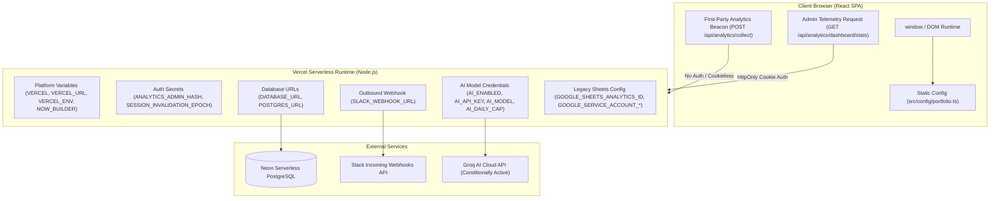
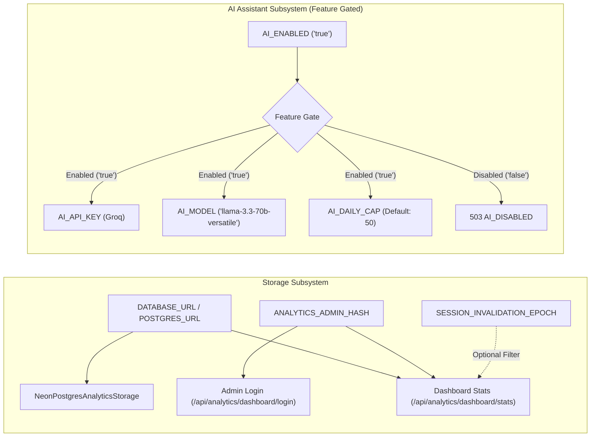

# Environment Variables & Configuration Contracts (ENV-CONTRACTS.md)

**Repository:** `C:\Users\kaust\OneDrive\Desktop\portfolio`  
**Active Branch:** `phase7-portfolio-intelligence`  
**Scope:** Exhaustive audit of all environment variables, configuration dependencies, fallback mechanisms, runtime contexts, and security boundaries across the portfolio codebase.  
**Status:** VERIFIED & GOVERNED — Final Accuracy Pass  

---

## 1. Project Overview

The portfolio is architectured as a lean **Single Page Application (SPA)** built with React 18, TypeScript, and Vite, coupled with a serverless API backend running on the Vercel Serverless Functions infrastructure. 

The application architecture enforces strict segregation:
- **Presentation Tier (`src/`):** Bundled statically by Vite into HTML/CSS/JS. It executes purely within the browser and contains **zero secret credentials**, zero tracking cookies, and zero server-side environment variables.
- **Serverless API Tier (`api/`):** Deployed as isolated Vercel serverless Node.js endpoints (Node 20.x/22.x ES modules). All database connection strings, authentication hashes, Slack webhooks, and third-party credentials reside exclusively within this tier via `process.env`.
- **Governed Analytics Infrastructure:** Uses `@neondatabase/serverless` for durable PostgreSQL storage when configured, with graceful non-persisted fallback when unconfigured, strictly adhering to the core principle: **`PRESERVE → DOCUMENT → FLAG → GOVERN`**.

---

## 2. Environment Configuration Architecture



### Key Architectural Tenets:
1. **Zero Client-Side Secret Exposure:** No environment variable in this repository uses the `VITE_` prefix. All secrets are inaccessible to client-side bundles and web scrapers.
2. **Fail-Safe Degradation:** Missing environment variables do not cause runtime crashes or application failures. Unconfigured storage triggers truthful HTTP 503 (`STORAGE_UNCONFIGURED`) or ephemeral in-memory diagnostics without fabricating metrics.
3. **Strict Origin & CSRF Isolation:** Serverless endpoints verify `req.headers.origin` against the trusted canonical domain (`https://kaustubh-portfolio-six.vercel.app`), local development hosts, and the platform-injected `process.env.VERCEL_URL` (rejecting arbitrary wildcard preview subdomains).

---

## 3. Complete Environment Variable Registry

The following tables document every exact, distinct environment-variable name discovered across the codebase. Wildcard patterns (such as build-system cache flags) and non-consumed tooling mentions (such as `NX_DAEMON`) are explicitly excluded from this discrete registry and documented in [Section 12](#12-docker-and-cicd-variables).

### 3.1 Registry Summary & Category Reconciliation

| Category | Count | Distinct Variable Names | Operational & Reachability Status |
| :--- | :---: | :--- | :--- |
| **Application Required (Subsystem-Specific)** | **3** | `SLACK_WEBHOOK_URL`, `DATABASE_URL`, `ANALYTICS_ADMIN_HASH` | Active when corresponding subsystem is invoked; deterministic fail-safe response when absent. |
| **Application Optional** | **4** | `POSTGRES_URL`, `SESSION_INVALIDATION_EPOCH`, `AI_ENABLED`, `AI_DAILY_CAP` | Optional fallbacks, emergency revocation switches, master feature gates, or rate limiters. |
| **Conditionally Active (Feature Gated)** | **2** | `AI_API_KEY`, `AI_MODEL` | Actively referenced in `api/lib/groqProvider.ts`; unreachable while `AI_ENABLED !== 'true'`, but actively required if the gate is opened. |
| **Platform Injected (Vercel)** | **4** | `VERCEL`, `VERCEL_URL`, `VERCEL_ENV`, `NOW_BUILDER` | Injected automatically by Vercel deployment/build containers; inspected for environment & origin guards. |
| **System & Tooling (Runtime/OS)** | **2** | `NODE_ENV`, `LOCALAPPDATA` | Node.js runtime environment and Windows local application data path. |
| **Test & Script Only** | **3** | `CHROME_BIN`, `CDP_PORT`, `TEST_BASE_URL` | Consumed strictly in offline Node test/audit scripts in `scripts/`. |
| **Permanently Inactive / Governed-Disabled** | **3** | `GOOGLE_SHEETS_ANALYTICS_ID`, `GOOGLE_SERVICE_ACCOUNT_EMAIL`, `GOOGLE_SERVICE_ACCOUNT_PRIVATE_KEY` | Inactive: Google Sheets sync credentials in deactivated `sheetsSync.ts` (permanently disabled by STRATOS governance). |
| **Total Enumerated Unique Variables** | **21** | *(All 21 unique names documented below)* | **Frontend / Public: 0 \| Backend / Private: 21** |

> **Category Reconciliation & Mathematical Proof:**  
> $$3\ (\text{Req}) + 4\ (\text{Opt}) + 2\ (\text{Cond}) + 4\ (\text{Platform}) + 2\ (\text{System}) + 3\ (\text{Test}) + 3\ (\text{Inactive}) = 21\ \text{Total Unique Variables}$$  
> 
> **Category Overlap & Alias Resolution Notes:**  
> - `DATABASE_URL` is cataloged as **Application Required** for the persistent SQL analytics subsystem, while `POSTGRES_URL` is cataloged as **Application Optional** because it functions as an alternate fallback alias (`process.env.DATABASE_URL || process.env.POSTGRES_URL`). Both are tracked as distinct registry entries.  
> - `AI_API_KEY` and `AI_MODEL` are classified as **Conditionally Active (Feature Gated)**: they are concrete code dependencies of `generateAssistantResponse()` in `api/lib/groqProvider.ts`, but are guarded upstream in `api/assistant.ts` by `if (process.env.AI_ENABLED !== 'true') return res.status(503)`. They are not permanently inactive legacy code, but operational prerequisites for the AI subsystem when enabled.

---

### 3.2 Master Registry Table (21 Distinct Variables)

| Variable Name | Category | Type | Default | Access Location | Consumer File & Lines | Build / Runtime | Exposure | Sensitive |
| :--- | :--- | :--- | :--- | :--- | :--- | :---: | :---: | :---: |
| `DATABASE_URL` | Storage / DB | URL String | `None` | `process.env.DATABASE_URL` | [`api/analytics/collect.ts:139`](file:///api/analytics/collect.ts#L139)<br>[`api/analytics/dashboard/login.ts:86`](file:///api/analytics/dashboard/login.ts#L86)<br>[`api/analytics/dashboard/stats.ts:42`](file:///api/analytics/dashboard/stats.ts#L42)<br>[`api/lib/analyticsStorage.ts:371`](file:///api/lib/analyticsStorage.ts#L371)<br>[`api/lib/authService.ts:122,160,208`](file:///api/lib/authService.ts#L122) | Runtime | Backend / Private | **Yes** |
| `POSTGRES_URL` | Storage / DB (Alias) | URL String | `None` | `process.env.POSTGRES_URL` | [`api/analytics/collect.ts:139`](file:///api/analytics/collect.ts#L139)<br>[`api/analytics/dashboard/login.ts:86`](file:///api/analytics/dashboard/login.ts#L86)<br>[`api/analytics/dashboard/stats.ts:42`](file:///api/analytics/dashboard/stats.ts#L42)<br>[`api/lib/analyticsStorage.ts:371`](file:///api/lib/analyticsStorage.ts#L371)<br>[`api/lib/authService.ts:122,160,208`](file:///api/lib/authService.ts#L122) | Runtime | Backend / Private | **Yes** |
| `ANALYTICS_ADMIN_HASH` | Auth / Security | Hash String | `None` | `process.env.ANALYTICS_ADMIN_HASH` | [`api/analytics/dashboard/login.ts:85`](file:///api/analytics/dashboard/login.ts#L85)<br>[`api/analytics/dashboard/stats.ts:43`](file:///api/analytics/dashboard/stats.ts#L43) | Runtime | Backend / Private | **Yes** |
| `SESSION_INVALIDATION_EPOCH` | Auth / Security | Epoch Integer | `None` | `process.env.SESSION_INVALIDATION_EPOCH` | [`api/lib/authService.ts:167-168`](file:///api/lib/authService.ts#L167-L168) | Runtime | Backend / Private | No |
| `SLACK_WEBHOOK_URL` | Notification | URL String | `None` | `process.env.SLACK_WEBHOOK_URL` | [`api/contact.ts:155`](file:///api/contact.ts#L155)<br>[`api/assistant.ts:110`](file:///api/assistant.ts#L110)<br>[`api/feedback.ts:254`](file:///api/feedback.ts#L254) | Runtime | Backend / Private | **Yes** |
| `AI_ENABLED` | Feature Gate | Boolean String | `'false'` | `process.env.AI_ENABLED` | [`api/assistant.ts:236-237`](file:///api/assistant.ts#L236-L237) | Runtime | Backend / Private | No |
| `AI_DAILY_CAP` | Rate Limiter | Integer String | `'50'` | `process.env.AI_DAILY_CAP` | [`api/assistant.ts:77`](file:///api/assistant.ts#L77) | Runtime | Backend / Private | No |
| `AI_API_KEY` | AI Provider (Gated) | API Key String | `None` | `process.env.AI_API_KEY` | [`api/lib/groqProvider.ts:88`](file:///api/lib/groqProvider.ts#L88) | Runtime | Backend / Private | **Yes** |
| `AI_MODEL` | AI Provider (Gated) | Model String | `None` | `process.env.AI_MODEL` | [`api/lib/groqProvider.ts:96`](file:///api/lib/groqProvider.ts#L96) | Runtime | Backend / Private | No |
| `VERCEL_URL` | Platform System | Hostname String | `None` | `process.env.VERCEL_URL` | [`api/analytics/collect.ts:66`](file:///api/analytics/collect.ts#L66)<br>[`api/lib/authService.ts:58`](file:///api/lib/authService.ts#L58)<br>[`api/assistant.ts:174`](file:///api/assistant.ts#L174)<br>[`api/feedback.ts:117-118`](file:///api/feedback.ts#L117-L118) | Runtime | Platform / Injected | No |
| `VERCEL` | Platform System | String (`'1'`) | `None` | `process.env.VERCEL` | [`api/assistant.ts:154`](file:///api/assistant.ts#L154)<br>[`api/feedback.ts:69`](file:///api/feedback.ts#L69)<br>[`scripts/generate_resume_pdf.mjs:420`](file:///scripts/generate_resume_pdf.mjs#L420) | Build & Runtime | Platform / Injected | No |
| `VERCEL_ENV` | Platform System | Enum String | `'production'` | `process.env.VERCEL_ENV` | [`api/assistant.ts:154`](file:///api/assistant.ts#L154)<br>[`api/feedback.ts:69,267`](file:///api/feedback.ts#L69) | Runtime | Platform / Injected | No |
| `NOW_BUILDER` | Legacy Platform | String (`'1'`) | `None` | `process.env.NOW_BUILDER` | [`scripts/generate_resume_pdf.mjs:420`](file:///scripts/generate_resume_pdf.mjs#L420) | Build-time | Platform / Injected | No |
| `NODE_ENV` | Node Standard | Enum String | `None` | `process.env.NODE_ENV` | [`api/assistant.ts:157`](file:///api/assistant.ts#L157)<br>[`api/feedback.ts:74`](file:///api/feedback.ts#L74) | Runtime | Standard System | No |
| `LOCALAPPDATA` | Windows System | Path String | `''` | `process.env.LOCALAPPDATA` | [`scripts/test_shareable_urls.mjs:30`](file:///scripts/test_shareable_urls.mjs#L30)<br>[`scripts/targeted_cdp_audit.mjs:21`](file:///scripts/targeted_cdp_audit.mjs#L21) | Test / Script | OS Injected | No |
| `CHROME_BIN` | Tooling / Script | Filepath String| `None` | `process.env.CHROME_BIN` | [`scripts/generate_resume_pdf.mjs:18`](file:///scripts/generate_resume_pdf.mjs#L18)<br>[`scripts/test_shareable_urls.mjs:18`](file:///scripts/test_shareable_urls.mjs#L18)<br>[`scripts/targeted_cdp_audit.mjs:9`](file:///scripts/targeted_cdp_audit.mjs#L9) | Test / Build | Local Tooling | No |
| `CDP_PORT` | Tooling / Script | Port Integer | `'9248'` / `'9235'` | `process.env.CDP_PORT` | [`scripts/test_shareable_urls.mjs:71`](file:///scripts/test_shareable_urls.mjs#L71)<br>[`scripts/targeted_cdp_audit.mjs:62`](file:///scripts/targeted_cdp_audit.mjs#L62) | Test / Script | Local Tooling | No |
| `TEST_BASE_URL` | Tooling / Script | URL String | `'http://127.0.0.1:4173'` | `process.env.TEST_BASE_URL` | [`scripts/test_shareable_urls.mjs:72`](file:///scripts/test_shareable_urls.mjs#L72)<br>[`scripts/targeted_cdp_audit.mjs:63`](file:///scripts/targeted_cdp_audit.mjs#L63) | Test / Script | Local Tooling | No |
| `GOOGLE_SHEETS_ANALYTICS_ID` | External (Disabled)| String | `None` | `process.env.GOOGLE_SHEETS_ANALYTICS_ID` | [`api/lib/sheetsSync.ts:49`](file:///api/lib/sheetsSync.ts#L49) | Runtime | Backend / Private | No |
| `GOOGLE_SERVICE_ACCOUNT_EMAIL`| External (Disabled)| Email String | `None` | `process.env.GOOGLE_SERVICE_ACCOUNT_EMAIL`| [`api/lib/sheetsSync.ts:50`](file:///api/lib/sheetsSync.ts#L50) | Runtime | Backend / Private | No |
| `GOOGLE_SERVICE_ACCOUNT_PRIVATE_KEY`| External (Disabled)| RSA Key String| `None` | `process.env.GOOGLE_SERVICE_ACCOUNT_PRIVATE_KEY`| [`api/lib/sheetsSync.ts:51`](file:///api/lib/sheetsSync.ts#L51) | Runtime | Backend / Private | **Yes** |

---

## 4. Required Variables

No variable is hard-required for the static portfolio frontend to render. However, specific serverless capabilities require exact configurations:

### 4.1 Contact Form Pipeline
- **`SLACK_WEBHOOK_URL`**
  - **Required for:** Forwarding visitor messages submitted via `/api/contact` to the administrative Slack channel.
  - **Failure Mode if Missing:** The endpoint gracefully halts and returns HTTP `503 Service Unavailable` (`code: 'CONFIG_ERROR'`, message: `"The messaging service is temporarily unconfigured. Please use the direct email or WhatsApp links."`). **Zero silent failure; zero data loss.**

### 4.2 Durable Analytics Pipeline (When Operating in Persistent Mode)
- **`DATABASE_URL`**
  - **Required for:** Connecting to Neon Serverless PostgreSQL to persist raw events, execute advisory-locked rollups, and manage admin sessions. (Fallback alias `POSTGRES_URL` accepted if present).
  - **Failure Mode if Missing:** Public collection falls back to transient in-memory diagnostics returning HTTP 200 (`code: 'DIAGNOSTIC_BUFFER_ACCEPTED'`). Dashboard authentication returns HTTP `503 AUTH_UNCONFIGURED`.
- **`ANALYTICS_ADMIN_HASH`**
  - **Required for:** Authorizing admin login requests via `/api/analytics/dashboard/login`.
  - **Format Requirement:** Must follow `scrypt$<salt_hex>$<derived_hex>` or `pbkdf2$<salt_hex>$<derived_hex>`.
  - **Failure Mode if Missing:** Login endpoint immediately aborts and returns HTTP `503 AUTH_UNCONFIGURED`.

---

## 5. Optional & Conditionally Active Variables

### 5.1 Optional Application Controls
- **`POSTGRES_URL`**
  - **Purpose:** Alternate database connection string supported automatically by Neon / Vercel Storage integrations. Checked if `DATABASE_URL` is absent.
- **`SESSION_INVALIDATION_EPOCH`**
  - **Purpose:** Emergency session revocation switch. Any session created before this Unix timestamp is automatically rejected by PostgreSQL queries.
  - **Default:** If absent (`null`), sessions expire naturally based on their 4-hour `expires_at` timestamp.
- **`AI_ENABLED`**
  - **Purpose:** Master feature gate controlling whether `/api/assistant` executes AI dispatches. Currently explicitly disabled (`'false'`).
- **`AI_DAILY_CAP`**
  - **Purpose:** Restricts total daily assistant invocations to prevent quota runaway.
  - **Default:** Defaults in code to `50` requests per UTC day if unconfigured or unparseable.

### 5.2 Conditionally Active AI Provider Variables
- **`AI_API_KEY`**
  - **Consumer:** [`api/lib/groqProvider.ts:88`](file:///api/lib/groqProvider.ts#L88) inside `generateAssistantResponse()`.
  - **Reachability Analysis:** When `AI_ENABLED !== 'true'`, requests halt at `api/assistant.ts:237` with HTTP 503 (`AI_DISABLED`), meaning `generateAssistantResponse()` is never reached and `AI_API_KEY` is not evaluated.
  - **Conditional Requirement:** If `AI_ENABLED` is switched to `'true'`, `AI_API_KEY` becomes an immediate hard requirement; if missing, `groqProvider.ts:91` throws `AI provider configuration error: AI_API_KEY environment variable is missing or empty`, resulting in HTTP 502 (`AI_PROVIDER_ERROR`).
- **`AI_MODEL`**
  - **Consumer:** [`api/lib/groqProvider.ts:96`](file:///api/lib/groqProvider.ts#L96) inside `generateAssistantResponse()`.
  - **Reachability Analysis:** Guarded identically to `AI_API_KEY`. Unreachable while `AI_ENABLED !== 'true'`.
  - **Conditional Requirement:** If `AI_ENABLED` is switched to `'true'`, `AI_MODEL` must specify the target LLM identifier (e.g. `llama-3.3-70b-versatile`); if omitted, `groqProvider.ts:99` throws a configuration error.
- **Production Value Verification Status:** `Unknown — requires verification in Vercel Dashboard`. Whether `AI_API_KEY` or `AI_MODEL` currently exist as encrypted values in the remote Vercel Production dashboard has not been verified from Git code inspection.

---

## 6. Frontend / Public Variables

- **Count:** **0 variables.**
- **Policy:** Strictly enforced. No `VITE_` variables exist in the codebase.
- **Verification:** Audited across all 152 files in `src/`. Zero calls to `import.meta.env.VITE_*` or `process.env.*` exist in the client presentation layer.

---

## 7. Backend / Private Variables

All server-side environment variables are accessed strictly inside serverless handlers (`api/`) or offline evaluation scripts (`scripts/`):
- `DATABASE_URL` / `POSTGRES_URL`
- `ANALYTICS_ADMIN_HASH`
- `SESSION_INVALIDATION_EPOCH`
- `SLACK_WEBHOOK_URL`
- `AI_API_KEY`
- `AI_MODEL`
- `AI_ENABLED`
- `GOOGLE_SHEETS_ANALYTICS_ID`
- `GOOGLE_SERVICE_ACCOUNT_EMAIL`
- `GOOGLE_SERVICE_ACCOUNT_PRIVATE_KEY`

---

## 8. Development Configuration

For local development (`npm run dev` and local API testing):
- Vite runs on `http://localhost:5173`.
- `api/lib/authService.ts` explicitly includes `http://localhost:5173`, `http://localhost:3000`, `http://127.0.0.1:5173`, and `http://127.0.0.1:3000` in `ALLOWED_DEV_ORIGINS`.
- Local `.env.local` contains developer overrides (git-ignored).
- If `DATABASE_URL` is absent, the developer sees explicit `"Storage: Unconfigured"` telemetry badges in the Portfolio Intelligence modal, allowing full visual debugging without provisioning a database.

---

## 9. Testing Configuration

When executing automated suites (`scripts/test_*.mjs`):
- `scripts/test_contact_api.mjs` temporarily mocks `process.env.SLACK_WEBHOOK_URL` and validates that missing webhooks return 503.
- `scripts/test_assistant_api.mjs` tests the kill-switch by setting `process.env.AI_ENABLED = 'false'` and testing 503 response contracts.
- `scripts/test_dashboard_auth_flow.mjs` verifies scrypt hash validation, token verification, and session lifecycle using ephemeral mocks.
- Chrome CDP audit scripts (`scripts/test_shareable_urls.mjs`, `scripts/targeted_cdp_audit.mjs`) accept `CHROME_BIN`, `CDP_PORT`, `TEST_BASE_URL`, and fallback to `%LOCALAPPDATA%\Google\Chrome\Application\chrome.exe` on Windows.

---

## 10. Staging & Preview Configuration

In Vercel Preview environments (`*.vercel.app`):
- `process.env.VERCEL_ENV` is set to `"preview"`.
- `process.env.VERCEL_URL` provides the ephemeral deployment host (e.g. `portfolio-git-feature-branch.vercel.app`).
- Cross-origin requests from preview origins are allowed only if the origin host exactly matches `process.env.VERCEL_URL`. Untrusted preview deployments (`arbitrary.vercel.app`) are rejected by `isAuthorizedOrigin` in `api/lib/authService.ts`.

---

## 11. Production Configuration

In Vercel Production (`https://kaustubh-portfolio-six.vercel.app`):
- **Canonical Origin:** `CANONICAL_PRODUCTION_ORIGIN = 'https://kaustubh-portfolio-six.vercel.app'`
- **Mandatory Production Invariants:**
  - `AI_ENABLED` must remain `'false'` (returns `503 AI_DISABLED`).
  - `SLACK_WEBHOOK_URL` routes to the live administrative channel.
  - `DATABASE_URL` connects to the authorized production Neon PostgreSQL branch once provisioned.
  - `ANALYTICS_ADMIN_HASH` contains the high-entropy scrypt-derived administrator passphrase hash.

---

## 12. Docker and CI/CD Variables

- **Docker:** The project does not utilize Docker or containerization; it deploys natively via Vercel Git integration.
- **CI/CD Platform Injections:** Vercel automatically injects Git metadata into build containers:
  - `VERCEL_GIT_COMMIT_SHA`
  - `VERCEL_GIT_COMMIT_REF`
  - `VERCEL_GIT_REPO_SLUG`
- In `scripts/generate_resume_pdf.mjs`, the script inspects `process.env.VERCEL === '1' || process.env.NOW_BUILDER === '1'` to detect if it is running inside the Vercel build environment, automatically falling back to the protected pre-rendered resume PDF to maintain the byte-for-byte invariant.
- **Wildcard Patterns & Non-Consumed Tooling Mentions:**
  - **`TURBO_*`:** Monorepo/caching build flags (e.g. `TURBO_TOKEN`, `TURBO_TEAM`). These are wildcard prefixes used by Turborepo tooling if configured, not enumerable discrete application variables. Zero consumer references exist in this codebase.
  - **`NX_DAEMON`:** An Nx build system daemon flag. An exhaustive scan across the repository (`api/`, `src/`, `scripts/`, `migrations/`, config files, and tests) confirmed **zero code consumers or reads of `NX_DAEMON`**. The string appeared solely as an external conceptual mention in documentation. It is therefore excluded from the discrete application variable inventory.

---

## 13. Variable Dependencies and Relationships



---

## 14. Defaults and Fallback Behavior

| Variable | Fallback When Absent | User / System Impact |
| :--- | :--- | :--- |
| `DATABASE_URL` | Falls back to `process.env.POSTGRES_URL`. If both absent, activates `TransientDiagnosticStorage` (in-memory 500-event buffer). | Events collected in memory during dev. Dashboard stats returns HTTP 503 `STORAGE_UNCONFIGURED`. Zero fabricated historical totals. |
| `ANALYTICS_ADMIN_HASH` | None. | Dashboard login returns HTTP 503 `AUTH_UNCONFIGURED`. Dashboard remains completely locked. |
| `SESSION_INVALIDATION_EPOCH`| None (`null` in SQL query). | Sessions remain valid until their natural 4-hour expiration (`expires_at > NOW()`). |
| `SLACK_WEBHOOK_URL` | None. | Form submissions return HTTP 503 `CONFIG_ERROR`. UI prompts user to use direct email or WhatsApp. |
| `AI_ENABLED` | Treated as disabled (`!= 'true'`). | All `/api/assistant` calls immediately return HTTP 503 `AI_DISABLED`. |
| `AI_DAILY_CAP` | Parses as integer; defaults to `50`. | Restricts daily Groq tokens if AI is ever enabled. |
| `AI_MODEL` | None (throws error in Groq provider). | AI service rejects dispatch with HTTP 502/503 if API key or model is missing when enabled. |
| `VERCEL_ENV` | Defaults to `'production'`. | Conservative security fallback for origin verification. |

---

## 15. Security and Exposure Risks

### Security Audit Scope & Evidence-Based Findings:

| Security Check | Verification Status | Verification Methodology & Evidence |
| :--- | :---: | :--- |
| **Client-Side Source Code Isolation** | **VERIFIED** | Audited all 152 source files in `src/`. Zero occurrences of `VITE_`, `import.meta.env`, or `process.env`. |
| **Hardcoded Secrets in Source Code** | **VERIFIED** | Static grep across `api/` and `src/` confirmed zero hardcoded API keys, tokens, or plaintext database passwords. |
| **Git Tracking Hygiene (`.env` files)** | **VERIFIED** | `.env`, `.env.local`, `.env.*.local` are explicitly listed in `.gitignore` (lines 20-24) and untracked. |
| **Production Bundle Inspection** | **NOT VERIFIED** | A dedicated static dump inspection of the remote production JavaScript distribution (`dist/assets/*.js`) was not performed in this session. |
| **Full Git History Secret Scan** | **NOT VERIFIED** | Automated git secret scanning tools (e.g. `trufflehog`, `gitleaks`) were not executed against full commit history. |

### Security Architecture Invariants:
1. **Client-Side Secret Isolation:** No environment variable in this repository uses the `VITE_` prefix. All secrets are inaccessible to client-side bundles and web scrapers.
2. **Local `.env.local` File:** If created locally, `.env.local` is listed in `.gitignore` on line 21 and remains untracked in Git.
3. **Deactivated Google Sheets Variables (`GOOGLE_SHEETS_*`):** Located in [`api/lib/sheetsSync.ts`](file:///api/lib/sheetsSync.ts). Because Google Sheets synchronization is permanently disabled by STRATOS governance policy, these variables are inactive and present no active operational attack surface.

---

## 16. Missing or Undocumented Variables

- **`PORTFOLIO_INTELLIGENCE_KEY` (Obsolete Reference in Documentation):**  
  Earlier Phase 7 documentation referenced `PORTFOLIO_INTELLIGENCE_KEY` as a plain Bearer token. This was superseded in Phase 7.2.2 by `ANALYTICS_ADMIN_HASH` and stateful session cookies (`auth_sessions`). Any residual reference in diagnostic scripts is legacy only.

---

## 17. Unused or Potentially Obsolete Variables

1. **`GOOGLE_SHEETS_ANALYTICS_ID`**
2. **`GOOGLE_SERVICE_ACCOUNT_EMAIL`**
3. **`GOOGLE_SERVICE_ACCOUNT_PRIVATE_KEY`**
   - *Status:* Referenced only in `api/lib/sheetsSync.ts`. Since Google Sheets synchronization is completely disabled by architectural decision (Phase 7.2.1.10), these variables are permanently inactive and do not need to be provisioned in Vercel.

---

## 18. Configuration Validation

Environment variables are validated on demand with bounded guards:

```typescript
// 1. Passphrase Hash Bounds Validation (api/lib/authService.ts)
if (!/^[0-9a-fA-F]{32,128}$/.test(saltHex) || !/^[0-9a-fA-F]{64,128}$/.test(expectedHex)) {
  return false;
}

// 2. Database URL Presence (api/lib/analyticsStorage.ts)
const dbUrl = process.env.DATABASE_URL || process.env.POSTGRES_URL;
if (!dbUrl) {
  cachedStorage = new TransientDiagnosticStorage();
}

// 3. AI Kill Switch (api/assistant.ts)
if (process.env.AI_ENABLED !== 'true') {
  res.status(503).json({ success: false, code: 'AI_DISABLED' });
}
```

---

## 19. Safe Setup Instructions (Template for Staging & Production)

To configure the portfolio in a new Vercel deployment without exposing secrets:

```bash
# 1. Contact Form Notification (Required for contact form forwarding)
SLACK_WEBHOOK_URL="https://example.com/slack-webhook-placeholder"

# 2. Portfolio Intelligence OS (Required for durable analytics)
DATABASE_URL="postgres://default:[password]@[endpoint].neon.tech/neondb?sslmode=require"
ANALYTICS_ADMIN_HASH="scrypt$[salt_32_hex]$[derived_key_64_hex]"
# Optional emergency epoch:
# SESSION_INVALIDATION_EPOCH="1762330000"

# 3. AI Assistant (Keep DISABLED in Production)
AI_ENABLED="false"
# AI_API_KEY="gsk_..."
# AI_MODEL="llama-3.3-70b-versatile"
# AI_DAILY_CAP="50"
```

---

## 20. Known Limitations and Unknowns

1. **Vercel Encrypted Environment Variables:** While variable names are audited across repository code, the exact values configured inside the remote Vercel Production dashboard cannot be extracted via Git and remain: `Unknown — requires verification in Vercel Dashboard`.
2. **Platform-Injected Variables:** `VERCEL_URL` and `VERCEL_ENV` are dynamically populated at container boot by Vercel; local emulation without Vercel CLI requires manual mocking in test harnesses.
3. **Database Provisioning:** `DATABASE_URL` is currently unconfigured in production pending Phase 7.3 database authorization.

---

*End of Environment Contracts Specification.*
