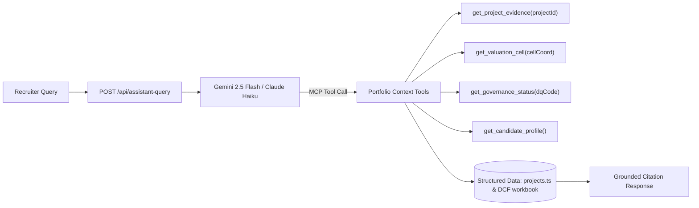

# Model Context Protocol & AI Architecture (MCP.md)

**Document Version:** 1.0.0  
**Status:** IMPLEMENTED & SPECIFIED  
**Repository:** `C:\Users\kaust\OneDrive\Desktop\portfolio`

---

## 1. Overview & Current Scope Disclosure

> [!NOTE]
> **Active Production State:**
> The live portfolio is currently deployed as a static client-side web application. It does **not run a live runtime Model Context Protocol (MCP) server or client daemon in production**.
>
> However, MCP servers and AI toolchains are actively utilized during **development, automated testing, quality auditing, and future Portfolio OS design**.

---

## 2. Development-Time MCP Toolchains & Integrations

During repository audits, QA automation, and agentic pair-programming, autonomous coding agents leverage the following MCP tool environments:

### 2.1 Chrome DevTools MCP & Browser Automation
- **Purpose:** Used by test scripts and autonomous agents to audit DOM offsets, calculate layout bounding rectangles, test multi-viewport rendering (375px to 1440px), and verify zero horizontal overflow.
- **Tools Utilized:** Browser inspection, screenshot capture, DOM bounding box retrieval, viewport emulation.

### 2.2 Local Diagnostic & Test Automation Scripts (`scripts/`)
Automated scripts execute via Node.js / Playwright / CDP to verify:
- `test_valuation_math.mjs`: Mathematical accuracy of the 25-node sensitivity matrix and Enterprise Value to Equity Value adjustments.
- `test_contact_api.mjs`: HTTP contract, honeypot defense, and rate-limiting enforcement on `/api/contact`.
- `test_shareable_urls.mjs`: URL query parameter parsing and `popstate` browser history synchronization.

---

## 3. Future Architectural Roadmap: Portfolio AI Assistant (Phase B)

As proposed in [`docs/portfolio-integrations.md`](file:///docs/portfolio-integrations.md), the future **Portfolio OS AI Assistant** will expose an MCP-compatible tool architecture:

### Proposed MCP Tools for the Portfolio Assistant:
1. `get_project_evidence`: Retrieves verified KPIs, methodology steps, and artifacts for a canonical project.
2. `get_valuation_cell`: Looks up audited formulas and figures from the PhonePe DCF workbook (e.g. `Cell C13`, `EV to Equity Value`).
3. `get_governance_status`: Returns the active validation status of a STRATOS data quality check (e.g. `DQ-10 REVIEW`).
4. `get_candidate_profile`: Returns verified academic milestones, internships, and work authorization facts.

---

## 4. Guardrails for Future MCP Implementations

- **Strict Grounding:** The assistant must never hallucinate metrics or invent corporate achievements.
- **Mandatory Attribution:** Every generated answer must cite canonical project IDs or workbook cell references.
- **Token Quotas:** Rate-limited to 5 queries per recruiter session to prevent API abuse.

---

## 5. Cross References
- Integrations: [`INTEGRATIONS.md`](file:///INTEGRATIONS.md)
- System Architecture: [`ARCHITECTURE.md`](file:///ARCHITECTURE.md)
- Agent Operating Rules: [`AGENTS.md`](file:///AGENTS.md)

