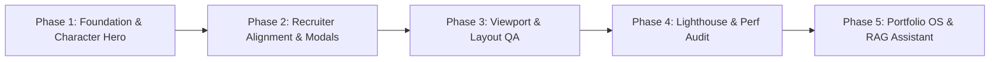

# Strategic Delivery Plan & Roadmap (PLAN.md)

**Document Version:** 1.0.0  
**Status:** ACTIVE  
**Repository:** `C:\Users\kaust\OneDrive\Desktop\portfolio`

---

## 1. Project Phase Progression

### Phase 1: Foundation & Character Hero (Completed)
- Extracted and pre-rendered 64 WebP frames for the 360° character hero.
- Built shortest-path angular lerp canvas tracking engine ($35\text{ ms}$ response).
- Established baseline dark theme and project catalog.

### Phase 2: Recruiter Alignment & Evidence Finalization (Completed)
- Structured the Recruiter Command Center for 30-second candidate scannability.
- Separated high-level modal briefs (`ProjectSummaryModal`, `&view=brief`) from deep technical case studies (`CaseStudyModal`).
- Verified PhonePe DCF valuation financial model line-by-line.

### Phase 3: Mobile Viewport & Layout QA (Completed)
- Enforced strict horizontal boundaries in `src/index.css`.
- Eliminated all layout spill across 375px, 430px, 768px, 1024px, and 1440px viewports ($0\text{ px}$ overflow).
- Audited interactive DOM offset bounds and container constraints.

### Phase 4: Performance, Accessibility & Release Audit (Completed)
- Achieved **100/100 Lighthouse Accessibility** across desktop and mobile.
- Aligned all `aria-label` prefixes to match visible button text (WCAG 2.5.3).
- Refactored definition lists in `EvidenceTelemetryBar`.
- Implemented lazy video loading (`preload="none"`, WebP poster, click-to-play) in `AboutSection`.
- Verified protected resume PDF integrity (96,435 bytes; SHA-1: `317857D88309548D9D05E8198FFBF8212C88470C`).

---

## 2. Future Roadmap: Portfolio OS Evolution (Phase 5)

Based on architectural specifications in `docs/portfolio-os-specification.md` and `docs/portfolio-integrations.md`:

### Milestone 5.1: Stakeholder Persona Switcher (Proposed)
- Introduce a 3-way segmented control in Hero: `[Recruiter] | [Founder] | [Enterprise Analytics]`.
- Dynamically reorder visual emphasis and primary call-to-actions without hiding public case studies.
- Persist selection in `sessionStorage` (`portfolio-persona`).

### Milestone 5.2: Interactive Project Scope & Budget Estimator (Proposed)
- Client-side scope builder for analytics consulting.
- Calculates estimated duration and indicative deliverables based on data source complexity, pipeline type, and visualization requirements.
- Pre-populates the contact inquiry form with the calculated project brief.

### Milestone 5.3: Grounded Conversational RAG Assistant (Proposed)
- Serverless API endpoint (`/api/assistant-query`) powered by Gemini 2.5 Flash / Claude Haiku.
- Strictly grounded in portfolio facts (`projects.ts`, `skills.ts`, audited DCF workbooks).
- Mandatory citation generation and strict zero-hallucination guardrails.

---

## 3. Risk & Mitigation Matrix

| Identified Risk | Severity | Mitigation Strategy |
| :--- | :---: | :--- |
| **Silent Imputation / Loss of Analytical Credibility** | High | Enforce strict operating rule: `PRESERVE → DOCUMENT → FLAG → GOVERN`. Keep STRATOS DQ-10 as `REVIEW`. |
| **Accidental Overwrite of Protected Resume** | High | Verify size (96,435 bytes) and SHA-1 in CI/pre-commit. Restore immediately if `npm run build` runs `build:resume`. |
| **Serverless Webhook Rate Flooding / Abuse** | Medium | Serverless token-bucket rate limiter (5 requests / 10 min) + hidden honeypot field. |
| **Mobile Performance Degradation from Video / Canvas** | Medium | Disable canvas tracking on touch; enforce `preload="none"` on secondary video; use lightweight WebP posters. |

---

## 4. Cross References
- Product Requirements: [`PRD.md`](file:///PRD.md)
- Architectural Decisions: [`DECISIONS.md`](file:///DECISIONS.md)
- Testing & Verification: [`TESTING.md`](file:///TESTING.md)

