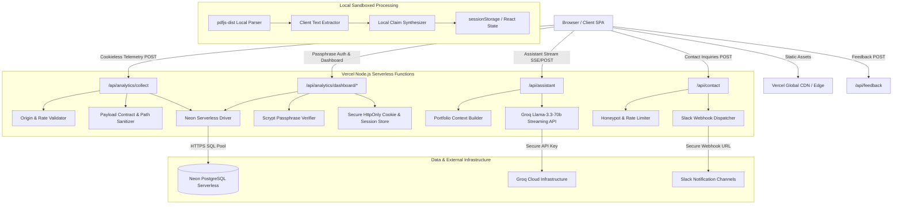

# System Architecture & Topology

> **Scope**: Structural design, component boundaries, communication protocols, and execution topology.  
> **Status**: `VERIFIED`

---

## 1. High-Level Architectural Model

The platform follows a modern **Decoupled Serverless & Client-Side Hybrid Architecture**. The user interface operates as a high-performance Single Page Application (SPA), while computational services, data persistence, and AI inference are distributed across lightweight serverless endpoints.

---

## 2. Tiered System Decomposition

### Tier 1: Client Presentation Layer (`src/`)
- Built with **React 18** and **TypeScript**, bundled via **Vite**.
- Uses an adaptive design system with atomic CSS (Tailwind) supporting seamless Dark and Light modes.
- Modals, popovers, and interactive drawers are rendered via React portals to guarantee clean DOM stacking.
- Key interactive modules:
  - `FlagshipPhonePe`: DCF sensitivity calculation engine.
  - `StratosDQMatrix`: Governed data quality engine.
  - `PortfolioIntelligenceModal`: Authenticated administrative telemetry viewer.
  - `RecruiterCommandCenter`: Keyboard-first navigational overlay (`Ctrl+K`).
  - `CandidateReview`: Client-side resume parsing and match scoring.

### Tier 2: Serverless Service Layer (`api/` and `server/lib/`)
- Stateless Vercel Node.js functions executing on-demand with minimal cold-start footprint.
- **Perimeter Defense**: Strict origin validation (`server/lib/originValidator.ts`) rejects untrusted referrers and unauthorized Vercel preview URLs.
- **In-Memory Rate Limiting**: Sliding-window rate limiters prevent brute-force attacks on login, contact submissions, and telemetry spam.
- **Data Governance Layer**: Payload normalization (`server/lib/analyticsContract.ts`) strips query strings, validates path structures via strict regex, and enforces allowed metadata schemas.

### Tier 3: Persistence & Upstream Layer
- **Neon Serverless Postgres**: Connects over HTTPS utilizing `@neondatabase/serverless`. No persistent socket connection pools are maintained, eliminating connection exhaustion issues.
- **Groq Inference Engine**: Real-time token streaming using `ReadableStream` directly into the client assistant window.
- **Slack Alerting Pipeline**: Dispatches structured, mrkdwn-formatted alert cards for inbound professional inquiries.

---

## 3. Communication Protocols & Boundaries

| Communication Channel | Source | Destination | Protocol / Format | Security & Isolation Controls |
| :--- | :--- | :--- | :--- | :--- |
| **Telemetry Ingestion** | Browser Client | `/api/analytics/collect` | HTTP POST (JSON) | Validated origin whitelist, path regex, query param stripping, rate limits. |
| **Admin Authentication** | Browser Client | `/api/analytics/dashboard/login` | HTTP POST (JSON) | Memory-hard scrypt verification, max 5 attempts/15 min, HttpOnly cookie. |
| **Dashboard Telemetry** | Browser Client | `/api/analytics/dashboard/stats` | HTTP GET | Authenticated session cookie validation, SHA-256 session hash lookup in DB. |
| **AI Assistant Stream** | Browser Client | `/api/assistant` | HTTP POST (SSE stream) | Grounded context injection, stream timeout abort controllers, token limits. |
| **Contact Submission**| Browser Client | `/api/contact` | HTTP POST (JSON) | Hidden honeypot field, email regex verification, Slack rate limiters. |
| **Resume Processing** | Local File | Browser Client | Client Memory (Buffer) | **Zero network transmission**. 100% sandboxed in browser DOM. |

---

## 4. Architectural Design Principles

1. **Defense in Depth**: Every API endpoint independently verifies origins, validates payload boundaries, checks IP rate limits, and sanitizes input data.
2. **Absolute Privacy by Design**: Telemetry strictly records actions and categories without capturing IP addresses, browser fingerprints, or personal identifiers.
3. **Graceful Degradation**: If Neon database connectivity or external Groq APIs are unreachable, the client displays deterministic, user-friendly fallback notices (e.g., `503 AUTH_UNCONFIGURED` or `STORAGE_UNAVAILABLE`) rather than crashing.
4. **Bundle Splitting & Lazy Evaluation**: Heavy interactive modules (`module-flagship-valuation`, `module-case-studies`, `vendor-libs`) are split into independent Rollup chunks to keep initial page load fast.

