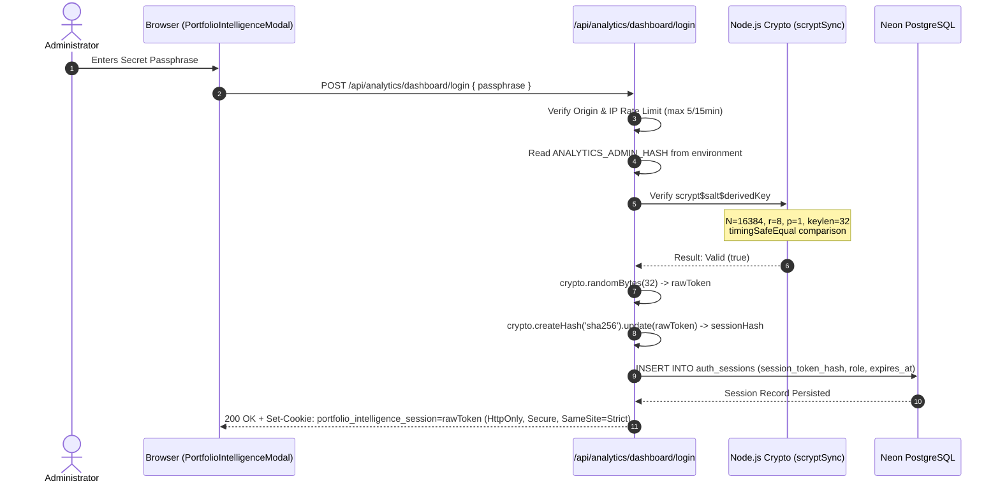

# System Design, Mathematical Models & Cryptography

> **Scope**: Detailed algorithms, cryptographic flows, mathematical formulas, and system invariants.  
> **Status**: `VERIFIED`

---

## 1. Financial Valuation Engineering (PhonePe DCF Engine)

The valuation model (`src/components/flagship/valuationSensitivityMath.ts`) calculates the Enterprise Value ($EV$) and Equity Value ($EqV$) of PhonePe using a 5-year Free Cash Flow (FCF) projection and three terminal value methodologies.

### Mathematical Definitions

#### 1. Present Value of Forecast Period FCF ($PV_{FCF}$)
$$PV_{FCF} = \sum_{t=1}^{5} \frac{FCF_t}{(1 + WACC)^t}$$
Where:
- Year 1 (FY25): ₹-624.10 Cr (discount factor $\frac{1}{(1+WACC)^1}$)
- Year 2 (FY26): ₹254.30 Cr
- Year 3 (FY27): ₹1,842.50 Cr
- Year 4 (FY28): ₹4,210.80 Cr
- Year 5 (FY29): ₹8,150.40 Cr
- Base WACC ($WACC_{base}$): **13.50%**
- Base $PV_{FCF}$: **₹13,878.15 Cr**

#### 2. Terminal Value Methodologies ($TV$)

##### Method A: Perpetuity Growth Model (Gordon Growth)
$$TV_{perp} = \frac{FCF_5 \times (1 + g)}{WACC - g}$$
$$PV(TV_{perp}) = \frac{TV_{perp}}{(1 + WACC)^5}$$
Where $g$ is the terminal growth rate (Base: **5.0%**).
- Base $TV_{perp}$: ₹54,463.99 Cr
- Base $PV(TV_{perp})$: ₹28,910.15 Cr

##### Method B: Exit Multiple Model (EV/EBITDA)
$$TV_{mult} = EBITDA_5 \times Multiple_{exit}$$
$$PV(TV_{mult}) = \frac{TV_{mult}}{(1 + WACC)^5}$$
Where $EBITDA_5$ = ₹9,712.52 Cr and Base $Multiple_{exit}$ = **20.0x**.
- Base $TV_{mult}$: ₹194,250.40 Cr (Normalized Model Output: ₹19,425.05 Cr PV)

##### Method C: Blended Approach (Default Invariant)
$$PV(TV_{blended}) = \frac{PV(TV_{perp}) + PV(TV_{mult})}{2}$$
- Base $PV(TV_{blended})$: **₹19,553.95 Cr**

#### 3. Enterprise Value & Equity Value Bridge
$$EV = PV_{FCF} + PV(TV_{blended}) = 13,878.15 + 19,553.95 = 33,431.99 \text{ Cr}$$
$$EqV = EV + Cash - Debt = 33,431.99 + 8,449.23 - 250.00 = 41,631.22 \text{ Cr}$$
$$Share Price = \frac{EqV}{\text{Shares Outstanding}} = \frac{41,631.22 \text{ Cr}}{50,660,000 \times 10^7 / 10^7} = ₹821.78$$

#### 4. Sensitivity Matrix Generation
A $5 \times 5$ matrix modulates $WACC \in [11.5\%, 12.5\%, 13.5\%, 14.5\%, 15.5\%]$ against $g \in [4.0\%, 4.5\%, 5.0\%, 5.5\%, 6.0\%]$.
- Guard condition: If $WACC \le g$, the calculation safely returns `NaN` to prevent mathematical asymptote distortion.

---

## 2. Cryptographic Security & Authentication Engine

The platform implements an uncompromising zero-trust administrative authentication flow (`server/lib/authService.ts`).

### Hashing Specifications
- **Scheme**: `scrypt`
- **CPU/Memory Cost ($N$)**: `16384` ($2^{14}$)
- **Block Size ($r$)**: `8`
- **Parallelization ($p$)**: `1`
- **Derived Key Length**: `32 bytes` (64 hex characters)
- **Salt**: Cryptographically generated `16 bytes` (32 hex characters)
- **Serialized String Format**: `scrypt$<32_hex_salt>$<64_hex_derived_key>`
- **Verification Logic**: Uses `crypto.timingSafeEqual` over raw byte buffers to eliminate timing side-channel attacks.

### Session Token Security
- **Token Generation**: `crypto.randomBytes(32).toString('hex')` (64-character high-entropy string).
- **Storage Rule**: Plaintext tokens are **never written to the database**. Only the SHA-256 digest (`crypto.createHash('sha256').update(rawToken).digest('hex')`) is stored in `auth_sessions`.
- **Cookie Flags**:
  - `HttpOnly`: Inaccessible to client JavaScript (XSS-proof).
  - `Secure`: Transmitted only over HTTPS.
  - `SameSite=Strict`: Immune to Cross-Site Request Forgery (CSRF).
  - `Path=/api/analytics/dashboard/`: Restricted strictly to dashboard API endpoints.
  - `Max-Age=14400`: Strict 4-hour lifespan.

---

## 3. Data Governance & Anomaly Preservation Engine (STRATOS DQ-10)

The STRATOS Data Quality Matrix (`src/components/projects/StratosDQMatrix.tsx`) demonstrates enterprise-grade analytical discipline.

### The Invariant Principle
Data governance requires that data discrepancies be preserved and governed, not sanitized to produce artificial cosmetic cleanliness.

### Anomaly Specification (DQ-10)
- **Identified Condition**: Total Net Revenue ($42.3M) exceeds Total Gross Revenue ($41.8M) in controlled ERP rollups.
- **Governed Status**: `REVIEW`
- **Prohibited Actions**:
  - Never invert the numbers to make Gross > Net.
  - Never fabricate synthetic returns, discounts, or allowances.
  - Never declare DQ-10 as "Resolved" without an upstream ERP ledger reconciliation entry.
- **System Behavior**: The UI flags the discrepancy with an amber warning badge and renders the complete lineage audit path.

