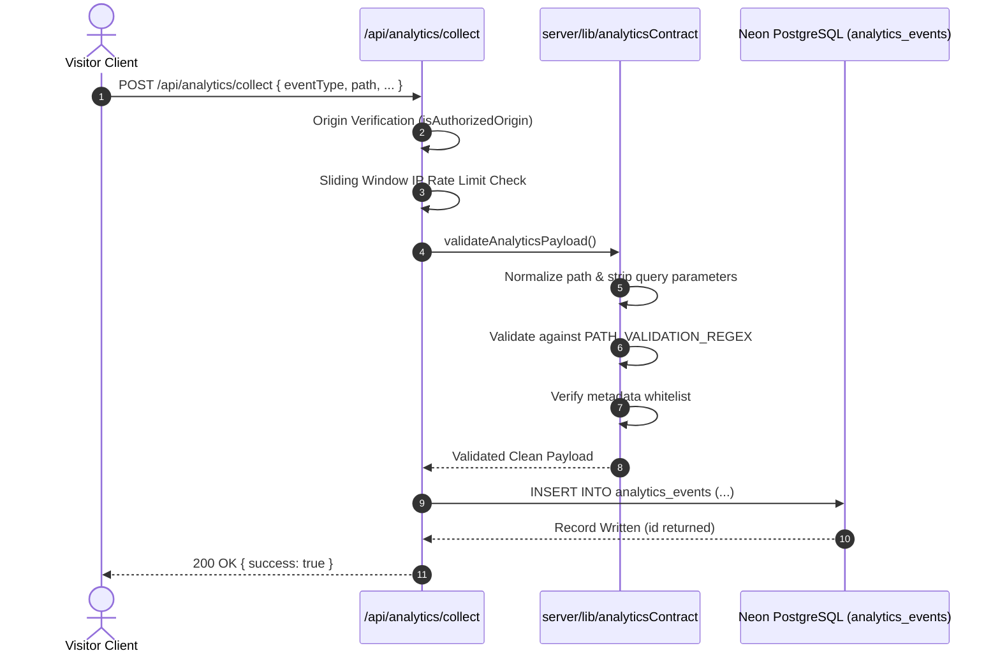

# Database Data Flow & Ingestion Lifecycle

> **Scope**: Ingestion lifecycles, write paths, read queries, aggregation rollups, and cache policies.  
> **Status**: `VERIFIED`

---

## 1. Telemetry Ingestion Write Path



---

## 2. Dashboard Analytics Read Path & Aggregation

When an authenticated administrator views the Portfolio Intelligence Dashboard, `api/analytics/dashboard/stats.ts` executes aggregated analytical queries via `server/lib/analyticsStorage.ts`:

1. **Volume & Conversion Aggregation**:
   ```sql
   SELECT 
     COUNT(*) AS total_events,
     COUNT(CASE WHEN event_type = 'page_view' THEN 1 END) AS page_views,
     COUNT(CASE WHEN event_type = 'project_view' THEN 1 END) AS project_views,
     COUNT(CASE WHEN event_type = 'resume_download' THEN 1 END) AS resume_downloads,
     COUNT(CASE WHEN event_type = 'contact_click' THEN 1 END) AS contact_clicks
   FROM analytics_events
   WHERE created_at >= NOW() - INTERVAL '30 days';
   ```
2. **Project Engagement Breakdown**:
   ```sql
   SELECT project_id, COUNT(*) AS count
   FROM analytics_events
   WHERE event_type = 'project_view' AND project_id IS NOT NULL AND created_at >= NOW() - INTERVAL '30 days'
   GROUP BY project_id
   ORDER BY count DESC;
   ```
3. **Device & Referrer Distributions**:
   ```sql
   SELECT device_category, COUNT(*) AS count
   FROM analytics_events
   WHERE created_at >= NOW() - INTERVAL '30 days'
   GROUP BY device_category;
   ```

