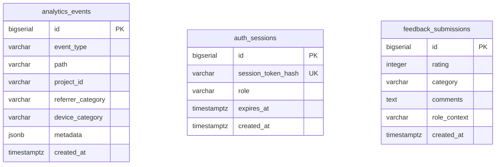

# Entity Relationships & Data Isolation

> **Scope**: Relational mapping, foreign keys, logical partitions, and tenant isolation.  
> **Status**: `VERIFIED`

---

## 1. Relational Entity Diagram

The database operates on an **event-driven, audit-first relational model** where tables are structurally decoupled to optimize write throughput and eliminate cascading locks.

---

## 2. Decoupled Structural Integrity

1. **Zero Foreign Keys**:
   - `analytics_events` and `feedback_submissions` do not maintain foreign keys to `auth_sessions`.
   - Telemetry must record uninterrupted visitor engagement even if sessions expire or are revoked.
2. **Deterministic Partitioning by Time**:
   - `created_at` provides natural time-range partitioning boundaries for 24-hour, 7-day, and 30-day analytics aggregation windows.
3. **Cryptographic Identity Decoupling**:
   - `auth_sessions` contains only SHA-256 hashes of tokens. A compromised database backup reveals zero plaintext session tokens.

