# Frontend Architecture & Client Engineering

> **Scope**: React 18 component model, rendering lifecycle, performance optimizations, and bundle architecture.  
> **Status**: `VERIFIED`

---

## 1. Architectural Model & Rendering Lifecycle

The client application is an ultra-fast, zero-layout-shift **Single Page Application (SPA)** written in **React 18** and **TypeScript**, bundled with **Vite 6**.

```mermaid
graph TD
    HTML[index.html] --> Main[src/main.tsx]
    Main --> ThemeProv[ThemeContext.Provider]
    ThemeProv --> App[src/App.tsx]

    subgraph App Shell Layout
        App --> Header[components/navigation/Header.tsx]
        App --> Hero[components/hero/HeroSection.tsx]
        App --> Flagship[components/flagship/FlagshipPhonePe.tsx]
        App --> Stratos[components/projects/ProjectsSection.tsx]
        App --> Journey[components/journey/JourneySection.tsx]
        App --> Skills[components/skills/SkillsSection.tsx]
        App --> Research[components/research/ResearchSection.tsx]
        App --> Contact[components/contact/ContactSection.tsx]
        App --> FAQ[components/faq/FAQSection.tsx]
    end

    subgraph Portals & Global Modals
        App --> CaseStudyModal[components/projects/CaseStudyModal.tsx]
        App --> CommandCenter[components/command/RecruiterCommandCenter.tsx]
        App --> IntelligenceModal[components/analytics/PortfolioIntelligenceModal.tsx]
        App --> AssistantDrawer[components/assistant/PortfolioAssistant.tsx]
        App --> FeedbackWidget[components/feedback/FeedbackWidget.tsx]
    end
```

---

## 2. Code Splitting & Chunk Optimization (`vite.config.ts`)

To guarantee immediate Largest Contentful Paint (LCP) and minimal initial JavaScript payload, production builds partition code into granular Rollup chunks:

| Chunk Name | Module Pattern / Path Filter | Primary Contents |
| :--- | :--- | :--- |
| **`vendor-core`** | `react`, `react-dom`, `clsx` | Core React runtime engine and class concatenation. |
| **`vendor-icons`** | `lucide-react` | Tree-shaken SVG icon primitives. |
| **`vendor-libs`** | `node_modules` (remaining) | Third-party auxiliary libraries. |
| **`module-flagship-valuation`**| `src/components/flagship/` | PhonePe DCF math, waterfall SVG chart, and sensitivity comparison table. |
| **`module-case-studies`** | `CaseStudyModal`, `ITSupportArchitectureInteractive`, `StratosDQMatrix` | Heavy case study overlays, architecture diagrams, and data quality matrices. |

---

## 3. DOM Stack Management & Portals

1. **Modals & Overlays**:
   - All modals mount into dedicated portal nodes or directly into `document.body` to prevent stacking context clipping from parent CSS transforms.
2. **Body Scroll Locking**:
   - When any modal (`CaseStudyModal`, `PortfolioIntelligenceModal`, `RecruiterCommandCenter`) opens, body scrolling is locked via `document.body.style.overflow = 'hidden'`.
   - On unmount, the previous overflow state is restored.
3. **Focus Trapping & Escape Handlers**:
   - Modals register global `keydown` listeners for the `Escape` key.
   - Initial focus is shifted to the modal dialog container for accessibility compliance.

