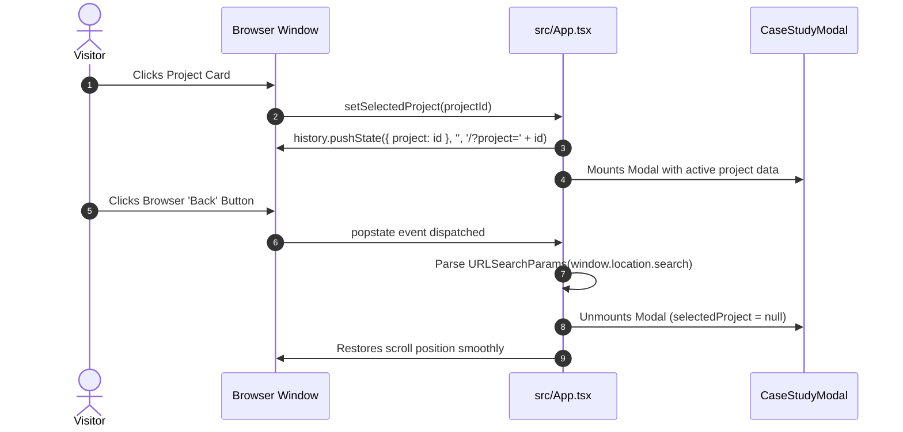

# Frontend Routing & Deep Linking

> **Scope**: URL parameter management, deep link routing, browser history reconciliation, and anchor scrolling.  
> **Status**: `VERIFIED`

---

## 1. Deep Linking & Shareable URLs

Rather than utilizing a heavyweight routing library (`react-router-dom`), the platform leverages **Native Browser History APIs (`window.history.pushState`)** for lightning-fast, zero-overhead navigation.

### Canonical URL Matrix

| Target View / Modal | Canonical URL Structure | Fallback Behavior |
| :--- | :--- | :--- |
| **Home / Root** | `https://kaustubh-portfolio-six.vercel.app/` | Normal homepage view |
| **PhonePe Valuation** | `/?project=phonepe-valuation` | Opens PhonePe Case Study Modal |
| **STRATOS Retail** | `/?project=stratos-governance` | Opens STRATOS Case Study Modal |
| **Spiideo Analytics** | `/?project=spiideo-sports-analytics` | Opens Spiideo Case Study Modal |
| **IT Support OS** | `/?project=it-support-analytics` | Opens IT Support Case Study Modal |
| **SmartBank 360** | `/?project=smartbank-360` | Opens SmartBank Case Study Modal |
| **EquiTrack OS** | `/?project=equitrack-analytics-os` | Opens EquiTrack Case Study Modal |
| **Project Summary** | `/?project=phonepe-valuation&view=summary` | Opens Compact Executive Summary |
| **Contact Anchor** | `/#contact` | Smoothly scrolls to Contact section |

---

## 2. History Reconciliation & Navigation Lifecycle

- When the modal is closed via the `Escape` key or backdrop click, `window.history.pushState({}, '', window.location.pathname)` cleanly strips the query parameter without causing a full page reload.

