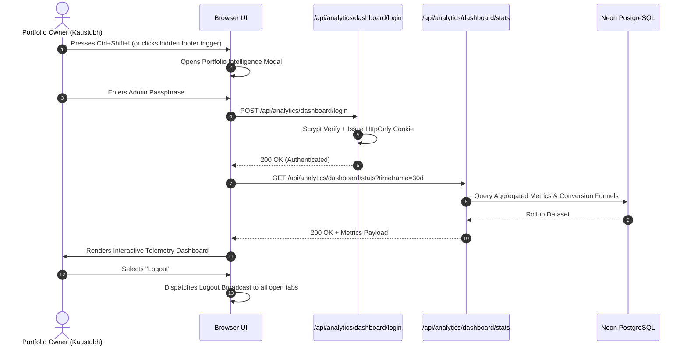

# Administrator Journeys & Observability Workflows

> **Scope**: Admin authentication, telemetry dashboard inspection, and operational tasks.  
> **Status**: `VERIFIED`

---

## 1. Journey: Authenticated Telemetry Monitoring



---

## 2. Journey: Local Passphrase Recovery

If the administrator needs to rotate or recover the local admin passphrase:
1. Open local terminal.
2. Execute:
   ```bash
   cmd /c "node scripts/reset_local_passphrase.mjs"
   ```
3. Enter new passphrase with masked asterisks.
4. The script:
   - Computes a new random 16-byte salt.
   - Derives a 32-byte scrypt key (`N=16384, r=8, p=1`).
   - Creates a timestamped backup of `.env.local`.
   - Writes `ANALYTICS_ADMIN_HASH=scrypt$<salt>$<hash>` to `.env.local`.
   - Validates the new hash immediately in-memory before terminating.

