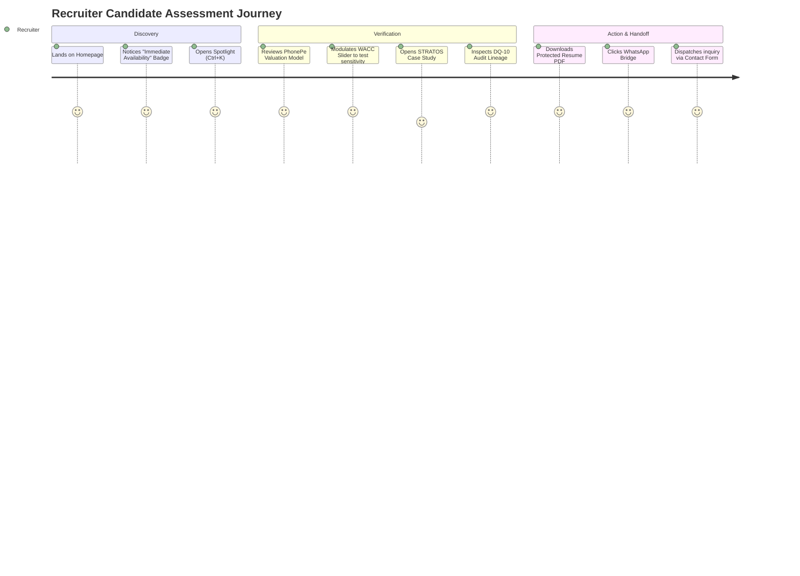

# End-to-End User Journeys & Recruiter Workflows

> **Scope**: Primary user flows, decision paths, and conversion funnels.  
> **Status**: `VERIFIED`

---

## 1. Journey 1: Executive Recruiter Fast-Track Evaluation

---

## 2. Journey 2: Staff Engineer / Architect Code Inspection

1. **Entry**: Visits via shared deep link (`/?project=phonepe-valuation`).
2. **Deep Dive**: Inspects the SVG waterfall chart and adjusts terminal value methodologies from Perpetuity to Exit Multiple.
3. **Architecture Review**: Opens the architecture section and reviews system documentation.
4. **Interactive Assistant**: Opens the AI assistant drawer (`PortfolioAssistant`) and asks: *"How does Kaustubh handle data governance and DQ-10 in STRATOS?"*.
5. **Outcome**: The assistant returns a grounded, factual answer citing the Apps Script governed source of truth without hallucinating resolution.

