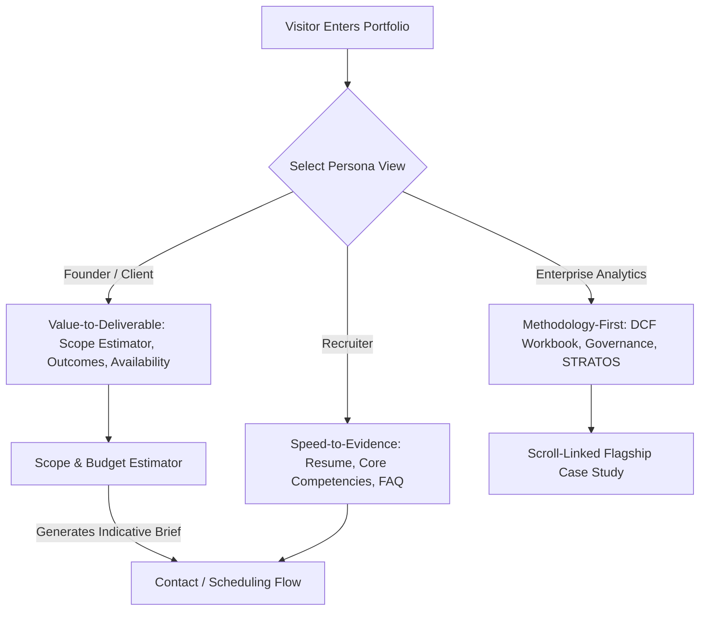

# Portfolio OS Feature Specification & Architectural Roadmap

**Project:** Kaustubh Nandurkar — Business Analytics & Financial Valuation Portfolio  
**Target Repository:** `C:\Users\kaust\OneDrive\Desktop\portfolio`  
**Current Baseline Git Commit:** `358457b` (working tree with Phase 1.1/1.2 verified enhancements)  
**Document Version:** 1.0.0 (Planning & Architectural Specification Only)  
**Date:** October 2026  
**Status:** PROPOSED — PENDING APPROVAL (No code changes implemented)

---

## 1. Executive Summary & Context

This planning specification outlines the design, UX architecture, data requirements, and delivery sequence for the next evolution of Kaustubh Nandurkar's portfolio: the **Portfolio OS**. 

The current portfolio successfully establishes credibility through quantitative rigor (PhonePe Pre-IPO DCF Valuation, STRATOS Retail Decision Intelligence, Spiideo match-event data pipeline). The next evolution transforms this static credibility showcase into an interactive, high-converting decision environment for recruiters, founders, and enterprise analytics leaders.

All proposals adhere strictly to governed principles:
- **Preserve Governed Data Integrity:** No synthetic benchmarks, fabricated causal claims, or simulated metrics.
- **Client-Side Lean Architecture:** Zero reliance on unneeded databases, heavy frameworks, or external tracking.
- **Privacy & Security First:** No client-side secret exposure, no invasive cookies, and clear separation of mailto vs. server-backed workflows.
- **Dark Editorial Identity:** Maintain the restrained, management-grade typography and aesthetic while ensuring full accessibility and performance.

---

## 2. Current-State Inventory (Repository Baseline)

Based on direct empirical inspection of the workspace (`git status --short`, source code, and CDP audits):

### A. Implemented & Verified Capabilities
1. **Governed Multi-Mode Theme System:**
   - 3-state switcher (`light`, `dark`, `system`) with `localStorage` persistence (`portfolio-theme`).
   - Anti-flash inline script in `index.html` preventing theme flickers on cold load.
   - Dynamic OS appearance change listener via `matchMedia('(prefers-color-scheme: dark)')`.
   - Saved preferences immune to URL query parameter tampering (`?theme=...`).
2. **Global Project & Skill Search Modal:**
   - Keyboard hotkey trigger (`Ctrl+K` / `Cmd+K`) and dedicated header pill.
   - Live multi-field filtering across projects, technical skills, and research papers.
   - Accessible ARIA dialog semantics, focus trap, and escape key dismissal.
   - Truthful empty state when queries yield zero matches.
3. **Structured FAQ Accordion Section:**
   - Recruiter-focused answers regarding methodology, EV-to-Equity bridging (PhonePe ₹41,631 Cr valuation), work authorization, and data governance.
   - Fully accessible accordion with keyboard controls and single-item expansion state.
4. **Editorial Header & Navigation:**
   - Sticky floating frosted pill with scroll progress indicator and quick resume download button.
   - Full-screen accessible mobile drawer dialog with focus trapping.
   - Dedicated skip-to-content landmark link (`#main-content`).
   - Floating `BackToTop` button visible past 450px scroll threshold with smooth return.
5. **Contact Touchpoints & Trust Signals:**
   - Truthful submit button wording (`"Open in Default Email Client"`).
   - Instant mailto link generation alongside 1-click clipboard message copying.
   - Hero quick-copy email button with tactile feedback.
6. **Print-Friendly Stylesheet:**
   - Native `@media print` rules stripping dark backgrounds, video canvases, and navigation bars to provide clean monochrome recruiter resumes.

### B. Proposed Features for Portfolio OS
The following 6 capabilities represent unbuilt features to be planned:
1. Persona-based experience switch (Recruiter vs. Founder vs. Enterprise).
2. Interactive project scope and budget estimator.
3. Live availability indicator and scheduling workflow.
4. Governed public analytics metrics panel.
5. Scroll-linked flagship case study deep-dive.
6. Selective premium motion and interaction polish.

---

## 3. Feature Specifications

---

### Feature 1: Persona-Based Experience Switcher

#### 1. User Problem & Target Persona
- **Problem:** Different stakeholders have divergent information priorities. Recruiters need instant validation of candidate fit within 30 seconds; founders need to know project deliverables, timelines, and business impact; enterprise leaders need deep architectural governance and quantitative methodology.
- **Target Personas:**
  - *Technical & Corporate Recruiters:* Scanning for skills, graduation timeline, work authorization, and downloadable artifacts.
  - *Founders / SMB Clients:* Seeking business analytics consulting, valuation modeling, or dashboard implementations.
  - *Enterprise BI & Analytics Directors:* Evaluating data architecture, SQL pipeline integrity, and governance compliance.

#### 2. Expected Portfolio & Conversion Value
- Reduces bounce rate and time-to-value by instantly rearranging content priority without hiding any public portfolio evidence.
- Demonstrates advanced product thinking and empathy for stakeholder workflows.

#### 3. Proposed UX & Interaction Flow
- A non-intrusive segment control at the top of the Hero section: `[For Recruiters] | [For Founders] | [For Enterprise Analytics]`.
- Switching view dynamically highlights corresponding case studies, adjusts the primary call-to-action (e.g., "Download Resume" vs. "Estimate Project Scope" vs. "Inspect Governance"), and reorders section emphasis smoothly.
- The state persists in `sessionStorage` (`portfolio-persona`) so it does not permanently overwrite general visitor defaults.
- A subtle dismissible chip indicates active view with a 1-click "Reset to Full View" option.

#### 4. Likely Components & Files Involved
- `src/context/PersonaContext.tsx` *(new)*: Manage active persona state.
- `src/components/hero/PersonaSelector.tsx` *(new)*: Segment control in Hero.
- `src/components/hero/HeroSection.tsx`: Dynamic primary CTA and badge tuning.
- `src/components/projects/ProjectsSection.tsx`: Persona-driven project sorting/tagging.
- `src/components/faq/FAQSection.tsx`: Default expanded FAQ item tied to persona.

#### 5. Data & Integrations Required
- Purely client-side state. Zero third-party tracking or external APIs.

#### 6. Accessibility, Responsive, Privacy, & Performance
- Standard `role="tablist"` or `role="radiogroup"` with keyboard arrow navigation.
- High-contrast visual indicator in both Light and Dark themes.
- Zero layout shift (CLS = 0) via pre-calculated grid slots.

#### 7. Acceptance Criteria
- Persona toggle operates via keyboard and click.
- Switching persona updates Hero CTA and reorders projects within <50ms without network roundtrip.
- Reloading the browser maintains selected persona in session; opening in a new tab defaults to 'General / All'.

#### 8. Dependencies, Risks, & Complexity
- **Complexity:** Low-Medium.
- **Risks:** Hiding key evidence if filtering is overly aggressive; mitigated by ensuring all content remains accessible via search and full view.

---

### Feature 2: Interactive Project Scope & Budget Estimator

#### 2.1 User Problem & Target Persona
- **Problem:** Potential clients, founders, and hiring managers often do not know how to scope analytical consulting projects (e.g., DCF financial modeling, Power BI dashboard migration, or data pipeline governance). Inquiries without structured scope require multiple back-and-forth emails.
- **Target Persona:** Startup Founders, Product Heads, and Consulting Clients.

#### 2.2 Expected Portfolio & Conversion Value
- Converts passive portfolio readers into qualified inbound leads.
- Pre-structures inbound contact messages with project scope, data readiness, timeline, and indicative budget tiers.

#### 2.3 Proposed UX & Interaction Flow
1. **Interactive Multi-Step Mini-Calculator:**
   - Step 1: *Project Domain* (Financial Valuation / DCF, BI Dashboard Development, Data Pipeline & Cleaning, Strategic Market Research).
   - Step 2: *Data Readiness* (Clean structured SQL/DB, Raw spreadsheets, Unstructured/Messy, No existing data).
   - Step 3: *Delivery Urgency* (Standard 2–4 weeks, Accelerated 1–2 weeks, Comprehensive multi-month).
2. **Instant Indicative Output Panel:**
   - Displays estimated effort (hours/sprints), deliverables checklist, and indicative budget bracket.
   - **Crucial Disclaimer:** Bold label stating: *"Indicative estimate for scoping purposes only. Not a binding quote or legal agreement."*
3. **1-Click Transfer to Contact Form:**
   - Clicking *"Proceed with this Scope"* automatically pre-fills the Contact Section form with the structured brief and scrolls directly to `#contact`.

#### 2.4 Likely Components & Files Involved
- `src/components/estimator/ProjectEstimator.tsx` *(new)*
- `src/components/estimator/estimatorData.ts` *(new data & calculation model)*
- `src/components/contact/ContactSection.tsx` *(accept incoming pre-filled brief)*

#### 2.5 Data & Integrations Required
- Deterministic client-side logic. Transparent scoring formula without black-box estimation.

#### 2.6 Accessibility, Responsive, Privacy, & Security
- Fully accessible form controls (`fieldset`, `legend`, radio pills, keyboard navigation).
- No sensitive client data transmitted over wire; calculation occurs entirely in browser memory.

#### 2.7 Acceptance Criteria
- Calculator produces deterministic, sensible timeline and bracket estimates based on selected parameters.
- Prominent non-binding disclaimer displayed at all times.
- "Transfer to Inquiry" cleanly pre-populates the Contact message field without data loss.

#### 2.8 Dependencies, Risks, & Complexity
- **Complexity:** Medium.
- **Risks:** Users interpreting brackets as fixed contracts; mitigated by explicit governance language and disclaimers.

---

### Feature 3: Live Availability Indicator & Scheduling Workflow

#### 3.1 User Problem & Target Persona
- **Problem:** Recruiters and clients have immediate timeline constraints (e.g., Summer 2027 full-time placement, immediate freelance consulting, or specific start dates). A portfolio without availability status causes uncertainty.
- **Target Persona:** Recruiters, Staffing Managers, Project Clients.

#### 3.2 Expected Portfolio & Conversion Value
- Urgency and transparency: clearly conveys when Kaustubh is available for internships, full-time MBA graduate placement (2027), or selected advisory engagements.
- Streamlines scheduling into a direct, low-friction channel.

#### 3.3 Proposed UX & Interaction Flow
- **Floating Availability Badge in Hero & Header:**
  - Pulsing status indicator: `● Available for Q3/Q4 Analytics Projects & 2027 Graduate Roles`.
  - Hovering/clicking opens an "Availability & Engagement Terms" mini-popover.
- **Scheduling Options:**
  - Primary: Low-friction direct email inquiry with pre-filled scheduling request.
  - Optional Embed / Link: External scheduling link (e.g., Cal.com or Google Meet) opened in new tab with clear external link disclosure, *only* if enabled by portfolio owner.
  - Zero iframe embeds that degrade page performance or leak third-party tracking.

#### 3.4 Likely Components & Files Involved
- `src/config/portfolio.ts`: Add `availability` schema (status, target roles, start date).
- `src/components/common/AvailabilityBadge.tsx` *(new)*
- `src/components/navigation/Header.tsx` & `src/components/hero/HeroSection.tsx`

#### 3.5 Data & Integrations Required
- Static configuration in `portfolioConfig`. Cal.com/Google Calendar direct URL (no runtime script tags).

#### 3.6 Accessibility & Privacy
- Status accessible to screen readers via `aria-label` and `aria-live="polite"`.
- Zero calendar cookie tracking or third-party vendor scripts loaded on initial page load.

#### 3.7 Acceptance Criteria
- Badge clearly displays current status across light and dark modes.
- Direct link opens scheduling client without blocking portfolio interaction.

#### 3.8 Dependencies, Risks, & Complexity
- **Complexity:** Very Low.
- **Risks:** Stale availability status if not maintained in configuration; mitigated by setting generic forward-looking dates (e.g., "MBA Class of 2027").

---

### Feature 4: Governed Public Analytics Metrics Panel

#### 4.1 User Problem & Target Persona
- **Problem:** Technical and executive reviewers want proof of quantitative depth before reading long text. They seek metrics that summarize portfolio data volume, accuracy, and model scope.
- **Target Persona:** Analytics Hiring Managers, Equity Research Directors, Enterprise BI Leads.

#### 4.2 Expected Portfolio & Conversion Value
- Provides instant evidence density. Elevates the portfolio from a standard CV page to an executive telemetry dashboard.

#### 4.3 Proposed UX & Interaction Flow
- A dedicated "Quantitative Evidence Telemetry" bar placed between Hero and About sections.
- 4–5 key governed metrics presented with crisp monospace figures and exact citations:
  1. **₹41,631 Cr:** Pre-IPO DCF Enterprise Valuation (PhonePe Model, 14.92% WACC).
  2. **100,000+ Rows:** Transactional datasets analyzed across SQL pipelines.
  3. **100% Governed:** Zero synthetic benchmarks; strict DQ compliance.
  4. **9 Sections:** Comprehensive multi-modal analytical evidence.
- Hovering over any metric displays a tooltip citing the exact workbook, sheet, or dataset source.

#### 4.4 Likely Components & Files Involved
- `src/components/metrics/EvidenceTelemetryBar.tsx` *(new)*
- `src/data/telemetryMetrics.ts` *(new metadata file grounding all figures)*

#### 4.5 Data & Integrations Required
- Grounded strictly in existing repository data (PhonePe valuation workbook, SQL case studies, and thesis datasets). Zero fabricated numbers.

#### 4.6 Accessibility & Performance
- Semantic `<dl>`, `<dt>`, `<dd>` elements for screen readers.
- Zero layout shift; crisp typography without heavy canvas charts.

#### 4.7 Acceptance Criteria
- Every metric has an unambiguous label, unit, and cited repository source.
- Fully responsive grid (2x2 on mobile, 4x1 on desktop).

#### 4.8 Dependencies, Risks, & Complexity
- **Complexity:** Low.
- **Risks:** Violating data governance rules by inventing metrics; mitigated by requiring strict source linking.

---

### Feature 5: Scroll-Linked Flagship Case Study Deep-Dive

#### 5.1 User Problem & Target Persona
- **Problem:** Currently, case studies open in standard modals (`CaseStudyModal.tsx`). While functional, modals isolate the reader from the narrative context and do not showcase progressive disclosure or sticky step-by-step model walk-throughs.
- **Target Persona:** Senior Business Analysts, Investment Associates, Analytics Directors.

#### 5.2 Expected Portfolio & Conversion Value
- World-class presentation of the flagship **PhonePe Pre-IPO DCF Valuation** or **STRATOS Retail Decision Intelligence**.
- Demonstrates senior analytical communication: *"What Matters &rarr; What Changed &rarr; Why &rarr; What To Do Next"*.

#### 5.3 Proposed UX & Interaction Flow
- An editorial, scrollytelling visual container for the flagship project:
  - Left Column (Sticky): Core valuation output summary, interactive waterfall chart (EV &rarr; Liquid Assets &rarr; Debt &rarr; Equity Value), and sensitivity matrix.
  - Right Column (Scrolling): Progressive narrative steps:
    - Step 1: *Transaction Context & Pre-IPO Landscape*
    - Step 2: *Revenue Drivers & 5-Year DCF Projection*
    - Step 3: *WACC Derivation (14.92%) & Terminal Growth Assumptions*
    - Step 4: *EV-to-Equity Bridge (₹8,915.23 Cr Liquid Assets vs. ₹716.00 Cr Debt)*
    - Step 5: *Strategic Risks & Sensitivity Matrix*
- As the visitor scrolls through the right narrative, the left panel smoothly highlights the corresponding step and model output.

#### 5.4 Likely Components & Files Involved
- `src/components/projects/flagship/FlagshipScrollytelling.tsx` *(new)*
- `src/components/projects/flagship/WaterfallBridgeChart.tsx` *(new SVG-based clean chart)*
- `src/components/projects/ProjectsSection.tsx`

#### 5.5 Data & Integrations Required
- Existing PhonePe valuation data from `scripts/phonepe_valuation.py` and `src/data/projects.ts`.

#### 5.6 Accessibility, Performance, & Motion Safety
- Pure CSS `position: sticky` and native `IntersectionObserver`. Zero heavy third-party scroll libraries (no ScrollMagic, no heavy GSAP).
- Respects `prefers-reduced-motion: reduce` by disabling smooth step transitions and presenting static stacked layout.
- Clean mobile fallback: transforms into a sequential vertical card deck.

#### 5.7 Acceptance Criteria
- Smooth scroll tracking without scroll jank or layout instability (60fps on standard desktop).
- Left panel accurately synchronizes with active narrative step.
- Mobile view degrades cleanly without clipped content.

#### 5.8 Dependencies, Risks, & Complexity
- **Complexity:** High.
- **Risks:** Scroll jank or mobile layout breakage if not built with pure CSS and lightweight observers.

---

### Feature 6: Selective Premium Motion & Interaction Polish

#### 6.1 User Problem & Target Persona
- **Problem:** Modern enterprise web experiences demand subtle micro-interactions that communicate polish without feeling gimmicky or distracting.
- **Target Persona:** All visitors (Recruiters, Founders, Peer Engineers).

#### 6.2 Expected Portfolio & Conversion Value
- High aesthetic finish and tactile responsiveness that elevates perceived technical caliber.

#### 6.3 Proposed UX & Interaction Polish
- Micro-interactions on key UI elements:
  - Subtle interactive magnetic cursor pull or border gradient glow on flagship project cards.
  - Monospace number tickers for metric transitions when scrolling into view.
  - Refined page anchor scroll transitions with spring easing.
  - Keyboard focus indicators styled as crisp double-ring red accents.

#### 6.4 Likely Components & Files Involved
- `src/index.css`: Keyframe definitions, reduced motion rules.
- `src/components/common/NumberTicker.tsx` *(new lightweight counter)*.

#### 6.5 Accessibility & Security
- Strict compliance with `prefers-reduced-motion`: all animations instantly disabled for users requesting reduced motion.
- Pure CSS and lightweight requestAnimationFrame logic (<2KB total overhead).

#### 6.6 Acceptance Criteria
- Performance audit maintains 95+ score on Lighthouse Performance.
- Zero CPU utilization when page is idle.

#### 6.7 Dependencies, Risks, & Complexity
- **Complexity:** Low-Medium.
- **Risks:** Over-animation causing distraction; mitigated by adhering to strict editorial restraint.

---

## 4. Architectural & Safety Principles

1. **Design System Consistency:**
   - Retain the governed Dark Editorial palette (`#0b0d13` background, `#ed2026` accent, Plus Jakarta Sans headers, JetBrains Mono data labels).
   - Light theme must preserve crisp readability (`#f8fafc` background, `#0f172a` text).
2. **Minimal Dependencies:**
   - No new external runtime dependencies unless proven indispensable.
   - Use native browser APIs (`IntersectionObserver`, `matchMedia`, `ResizeObserver`, CSS Grid/Flexbox, SVG).
3. **Indicative vs. Binding Logic:**
   - All estimator outputs must carry explicit disclaimers: *"Indicative analytical estimate only. Subject to formal scope alignment."*
4. **Data Governance & Metric Provenance:**
   - Never invent or fabricate metrics. Every number must have a verifiable file or workbook reference in the repository.
5. **Security & Secrets:**
   - Zero API keys, database credentials, or private tokens in client-side code.
   - Contact form remains client-side mailto + clipboard copy unless a secure, rate-limited serverless endpoint is explicitly approved and deployed.

---

## 5. Recommended Delivery Sequence

| Phase | Feature | User Value | Effort | Risk | Rationale |
| :---: | :--- | :---: | :---: | :---: | :--- |
| **Phase 2.1** | **Availability Indicator & Engagement Terms** | High | Low | Very Low | Quickest to deliver; immediately clarifies candidate timeline for recruiters and clients. |
| **Phase 2.2** | **Governed Public Analytics Metrics Panel** | High | Low | Low | Provides immediate evidence density and anchors technical credibility above the fold. |
| **Phase 2.3** | **Persona-Based Experience Switcher** | Very High | Medium | Low | Maximizes conversion for recruiters vs. enterprise visitors without duplicating code. |
| **Phase 2.4** | **Interactive Project Scope & Budget Estimator** | High | Medium | Medium | Engages prospective clients and pre-qualifies inbound inquiries before submission. |
| **Phase 2.5** | **Scroll-Linked Flagship Case Study (PhonePe)** | Very High | High | Medium | The marquee differentiator that showcases institutional-grade analytical storytelling. |
| **Phase 2.6** | **Selective Motion & Interaction Polish** | Medium | Low-Med | Low | Final aesthetic refinement applied once core functional surfaces are solidified. |

---

## 6. Smallest Coherent Next Release: Phase 2.1 & 2.2

The recommended immediate next release is **Phase 2.1 (Availability Indicator) + Phase 2.2 (Evidence Telemetry Bar)**:
- **Why First:** They require zero structural overhaul, introduce zero external dependencies, require minimal code, and instantly communicate two critical missing signals: *When is Kaustubh available?* and *What scale of quantitative work has been verified?*
- **Measurable Acceptance Criteria for Next Release:**
  1. Availability status badge rendered in Header and Hero with responsive fallback.
  2. Telemetry panel displays 4 verified metrics with exact source citations on hover/focus.
  3. Zero regressions in Lighthouse accessibility, performance, or existing Phase 1 test suite.
  4. 100% passing TypeScript compilation and Vite build.

---

## 7. Baseline & Repository Safety Summary

Current repository baseline verified and preserved:
- **Tracked files modified in working tree:** 6 (`index.html`, `src/App.tsx`, `src/components/hero/HeroSection.tsx`, `src/components/navigation/Header.tsx`, `src/index.css`, `tailwind.config.js`).
- **Protected scripts status:** All 7 scripts untouched (`git diff --stat scripts/` = 0).
- **Protected assets:** Video duplicates and verified resume PDF intact.
- **QA & test scripts:** `scripts/qa_audit.mjs` and all verification tools preserved for continuous testing.
- **Action taken:** Zero application files modified, zero files deleted, zero git commits staged.
